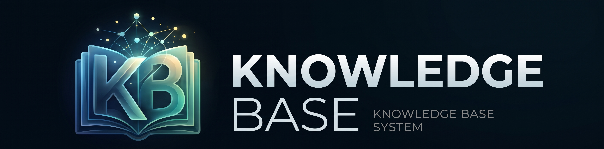
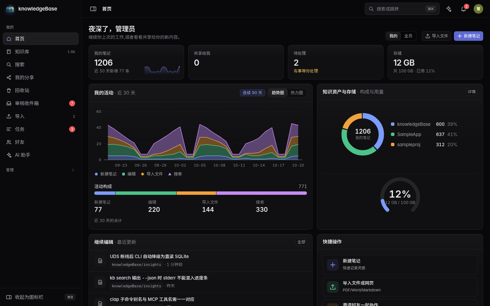
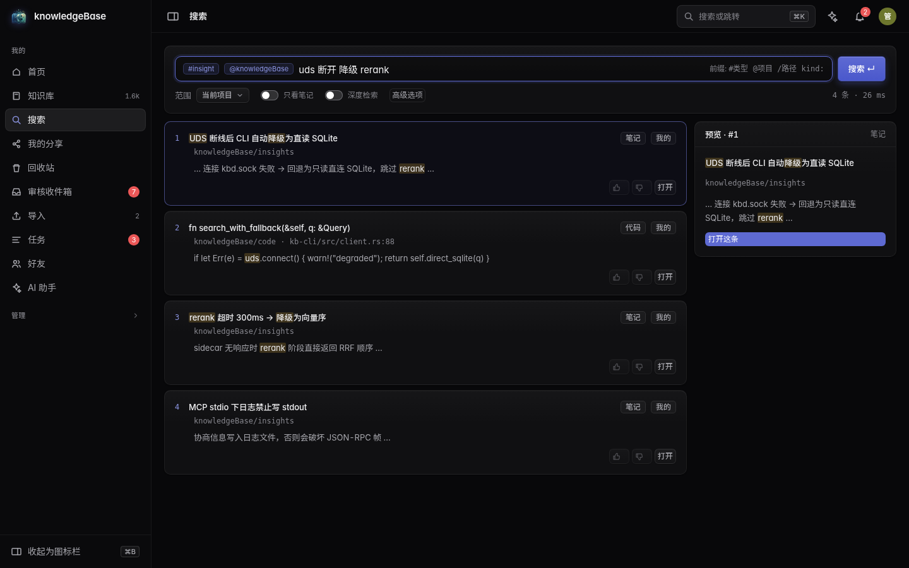
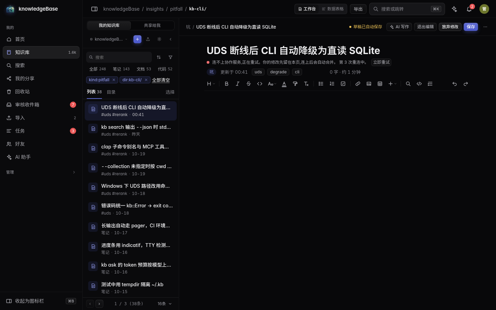
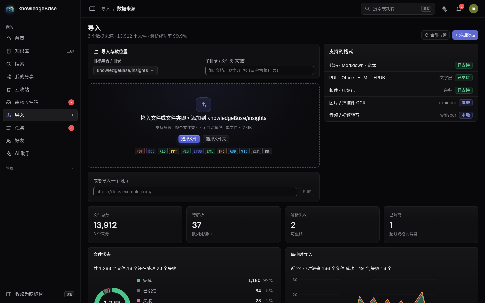
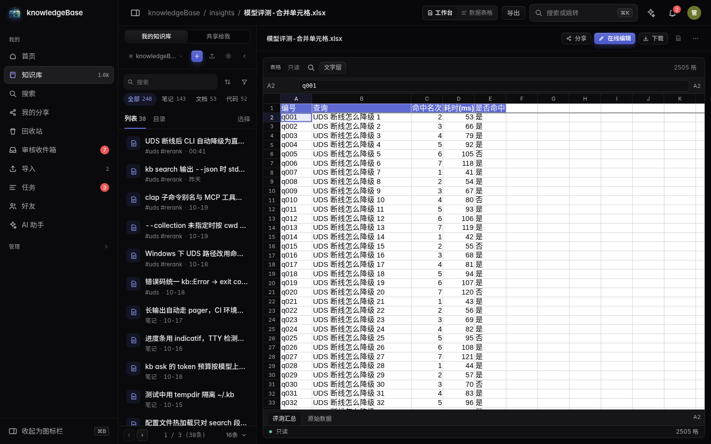
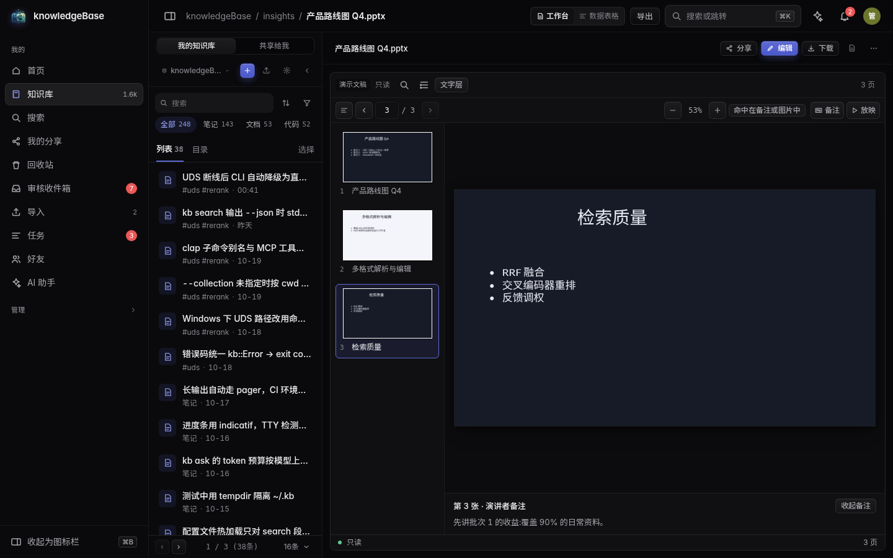
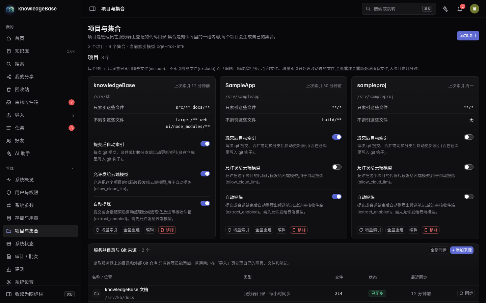
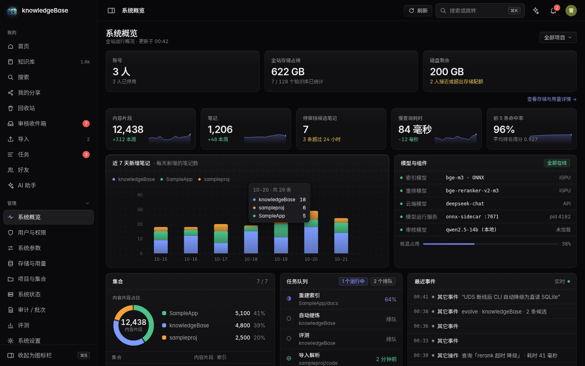
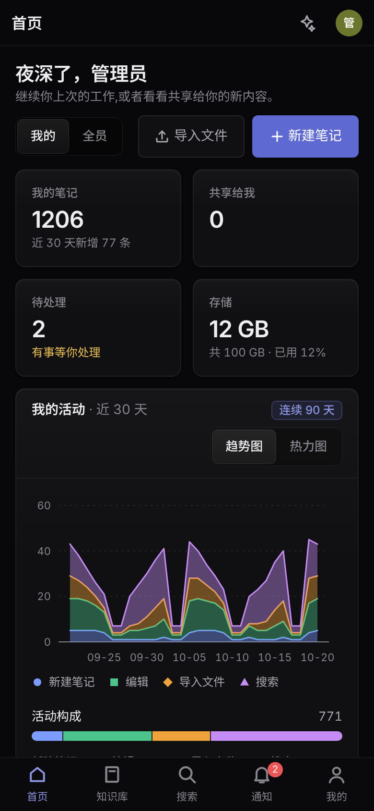

<p align="center">
  
</p>

<p align="center">
  <a href="README.md">简体中文</a> · <a href="README.en.md">English</a>
</p>

<h1 align="center">knowledgeBase</h1>

<p align="center">
  <strong>A local-first knowledge base for AI-assisted development</strong><br/>
  Rust daemon · MCP server · Vue 3 admin UI
</p>

<p align="center">
  <a href="LICENSE"></a>
  
  
  
</p>

knowledgeBase indexes code, documents and engineering notes into a searchable, editable knowledge base.
It exposes retrieval and authoring tools to AI clients over MCP, and ships with an authenticated web UI
for browsing, editing, collaboration and evaluation.

> **Source-available, not a hosted service.** This repository contains source code only.
> The author does not operate a public instance.
> Licensed under PolyForm Noncommercial 1.0.0: free for personal and noncommercial use;
> commercial use is not permitted. See [LICENSE](LICENSE) for the binding terms.

## Screenshots

> Screenshots are generated from deterministic public fixtures; all data is sample data.

<table>
  <tr>
    <td width="50%" align="center"></td>
    <td width="50%" align="center"></td>
  </tr>
  <tr>
    <td align="center"><sub>Home · personal workspace</sub></td>
    <td align="center"><sub>Search · hybrid retrieval and RRF explanation</sub></td>
  </tr>
  <tr>
    <td width="50%" align="center"></td>
    <td width="50%" align="center"></td>
  </tr>
  <tr>
    <td align="center"><sub>Knowledge base · editor and relation panel</sub></td>
    <td align="center"><sub>Import · data sources</sub></td>
  </tr>
</table>

<details>
<summary>More screenshots: Office preview, projects, admin overview, mobile</summary>

<table>
  <tr>
    <td width="50%" align="center"></td>
    <td width="50%" align="center"></td>
  </tr>
  <tr>
    <td align="center"><sub>Excel preview</sub></td>
    <td align="center"><sub>PowerPoint preview</sub></td>
  </tr>
  <tr>
    <td width="50%" align="center"></td>
    <td width="50%" align="center"></td>
  </tr>
  <tr>
    <td align="center"><sub>Projects and collections</sub></td>
    <td align="center"><sub>Admin · system overview</sub></td>
  </tr>
</table>

<p align="center">
  
</p>
<p align="center"><sub>Mobile home</sub></p>

</details>

## Why knowledgeBase

Most teams already have the raw material for an internal knowledge base: repositories, design docs,
meeting notes, runbooks and the lessons learned while debugging. The hard part is keeping that material
searchable, current and usable by AI tools without shipping the whole private corpus to a SaaS vendor.

knowledgeBase runs on your own machine or server. It keeps the source of truth in local files and local
databases, exposes a small permissioned MCP surface to AI clients, and gives humans a web UI for the work
that needs judgment: reviewing candidates, editing documents, resolving links and checking retrieval quality.

## Features

- **Hybrid retrieval** — LanceDB vector search plus a native BM25 index, fused with RRF;
  Chinese text is segmented with jieba.
- **Broad indexing** — tree-sitter code chunks; Markdown, plain text, PDF, Office
  (docx / xlsx / pptx), ODT, RTF, HTML, EPUB, email and archive extraction.
  Legacy Office formats (doc / xls / ods) can be converted through an optional LibreOffice runtime.
- **Knowledge evolution** — git hooks and session events produce candidate insights;
  an LLM review step promotes them, or routes them to a human review inbox depending on
  `evolution.review_mode` (`ai`, `ai_then_human`, `human`).
- **Document workbench** — browse and edit Markdown, text, CSV/TSV and uploaded Office files;
  links, versions, comments, sharing and a document-level permission model are built in.
- **Real-time collaboration** — multiple people can edit notes, Markdown, text, CSV/TSV and
  uploaded Word / Excel / PowerPoint files, with live cursors and autosave.
- **Admin and operations** — users and roles, quotas, AI budgets, projects and collections,
  ingest queues, audit logs, retrieval evaluation, backups and system health.
- **AI integration** — MCP over stdio for local clients and an authenticated `/mcp` HTTP endpoint;
  the same capability registry backs the web UI, CLI and MCP tools.
- **Bring your own model** — local embeddings through FastEmbed; optional external LLM and ACP
  coding agents are configured explicitly, not enabled by default.

## Architecture at a glance

```text
AI clients (Kiro / Claude Code / Codex / other MCP clients)
        │  MCP stdio or authenticated HTTP
        ▼
kb daemon (Rust)
  ├─ metadata: SQLite
  ├─ retrieval: LanceDB vectors + BM25, RRF fusion
  ├─ embeddings: FastEmbed (local)
  ├─ capabilities, auth, audit, backup
  └─ ingest and evolution pipelines
        │
        ├── Vue 3 web UI (Vite)
        ├── office-worker (Node 22 + WebAssembly Office engines)
        └── ACP agent bridge (optional)
```

The daemon is the only component that owns storage. The web UI, CLI and MCP server are clients of the
same capability layer, so permissions and audit rules do not diverge between surfaces.

## Requirements

- Linux (tested on Debian 13; systemd is optional but recommended for a long-running instance)
- Rust 1.91+ (`rust-toolchain.toml` pins 1.99.1)
- Node.js 22 and npm 10+
- `g++`, `protobuf-compiler`, `pkg-config`, `libssl-dev`
- A few GB of free disk space for the model cache and vector index
- Optional: LibreOffice for legacy Office conversion; a local or remote LLM for evolution and AI features

## Install

```bash
git clone https://github.com/dada1212121121/knowledgeBase.git
cd knowledgeBase

# Build the web UI first; the daemon can serve the built assets from web-ui/dist.
(cd web-ui && npm ci && npm run build)

# Cold Rust build: roughly 25–35 minutes on a typical development machine.
cargo build --release
export PATH="$PWD/target/release:$PATH"

kb doctor
```

`kb doctor` checks directories, disk, memory, the model cache, proxy settings and other runtime
prerequisites. Embedding models are cached under `~/.cache/kb-models` by default and downloaded from
Hugging Face on first use. If you already have the models, point `[embed] models_dir` in
`config.toml` at the existing cache instead of downloading them again.

### Run as a systemd service

```bash
kb service install          # system scope when run as root; user scope with --user
kb service status
kb service uninstall
kb service install --print  # print the unit without writing it
```

### Docker (optional)

```bash
docker build -t knowledgebase:dev .
docker run -d --name kb -p 7878:7878 -v kb-data:/data knowledgebase:dev
# Set the web password after the first start (read from stdin):
docker exec -it kb kb auth set-password
```

The image runs as a non-root user (UID 10001) with data under `/data`. The entrypoint only writes
`/data/config.toml` when it does not exist; mount your own config to take full control of the listen
address. The image contains the daemon and web UI only. Office collaboration requires the
`office-worker` Node process; install it separately as described in [docs/PLUGINS.md](docs/PLUGINS.md).

## Quick start

```bash
kb daemon                         # foreground; add --detach to background it
```

In another terminal (the password can only be set over the local Unix socket, so start the daemon first):

```bash
printf '%s\n' 'your-password' | kb auth set-password
```

Open `http://127.0.0.1:7878` and sign in. The listen address is configured by `[server] listen`.

```bash
kb project add /srv/workspace/myproj   # register a project; creates a collection and queues a full index
kb jobs                                # watch ingest progress
kb search "how does the CLI fall back when UDS disconnects"
kb eval                                # evaluate retrieval against the golden set
```

## Connect AI tools (MCP)

```bash
kb integrate kiro                    # print a config snippet only
kb integrate claude --apply         # write it into the client config
kb integrate codex --apply
```

MCP is available in two modes:

- `kb mcp` — stdio transport, started by a local client.
- `/mcp` — HTTP endpoint that requires a Bearer token created with `kb auth token create`.

The MCP surface exposes 16 tools in four groups:

| Group | Tools |
|---|---|
| `knowledge` | `search_knowledge`, `search_code`, `get_item`, `list_collections`, `list_projects`, `agent_history` |
| `jobs` | `job_list`, `list_ingest`, `reindex_project` |
| `insight` | `save_insight`, `kb_feedback` |
| `docs` | `doc_read`, `doc_edit`, `check_links`, `doc_links`, `list_files` |

`agent_history` is available only on the local stdio and ACP companion surfaces; remote `/mcp`
clients with Bearer tokens cannot see it. ACP agents expose the `knowledge` group by default.
Write operations go through capability permissions and the batch/undo mechanism. Admin-level
capabilities are limited to browser sessions and the local `kb.sock`.

## Configuration

The default home is `~/.kb`; override it with `KB_HOME`. The main configuration file is
`<KB_HOME>/config.toml`. Common sections:

| Section | Purpose |
|---|---|
| `[server]` | Listen address, public URL, session and upload limits |
| `[embed]` | Embedding model, cache directory, batch size |
| `[search]` | Hybrid retrieval, RRF weights, per-collection weights |
| `[evolution]` | Review mode, session roots, automatic extraction |
| `[llm]` | Optional external LLM endpoint, model and budgets |
| `[backup]` | Schedule, retention, mirror directories |
| `[office]` | Online Office editing and collaboration |

Secrets such as API keys belong in `<KB_HOME>/secrets.toml` and must never be committed.
See [docs/guide/USER_GUIDE.md](docs/guide/USER_GUIDE.md) for a complete reference.

## Documentation

Most in-depth documents are currently written in Chinese; this English README covers the overview,
installation and integration path.

| Document | Contents |
|---|---|
| [User guide](docs/guide/USER_GUIDE.md) | First login, import, search, editing, sharing and MCP |
| [MCP integration](docs/INTEGRATION.md) | Client configuration and tool reference |
| [Multi-user administration](docs/MULTI_USER_ADMIN.md) | Accounts, roles, quotas, AI budgets, sharing and guests |
| [Backup and restore](docs/BACKUP_RESTORE.md) | Scheduling, mirrors, verification, restore and rollback |
| [Editor extensions](docs/EDITOR_EXTENSIONS.md) | Commands, toolbars, codecs, content surfaces and AI tools |
| [Plugins](docs/PLUGINS.md) | Plugin directories, manifests and permissions |
| [Architecture](ARCHITECTURE.md) | Layers, data model, retrieval pipeline and trade-offs |
| [Feasibility notes](FEASIBILITY.md) | Measured dependencies, performance and deployment constraints |
| [Release process](docs/RELEASING.md) | Versioning, verification, artifacts and tagging |
| [Changelog](CHANGELOG.md) | User-visible changes by release |
| [Roadmap](ROADMAP.md) | Current focus and explicit non-goals |
| [Support](SUPPORT.md) | Documentation entry points, asking questions and scope |

## Development

```bash
scripts/install-hooks.sh      # pre-push fast checks
scripts/verify.sh --fast      # format, architecture gates, clippy, core tests, web lint + tsc
scripts/verify.sh --full      # adds all Rust tests, vitest, serve.mjs and a no-dist kb-web check

# Individual commands
cargo fmt --all -- --check
cargo clippy --workspace --all-targets --locked -- -D warnings
cargo test --workspace --locked

# Web
cd web-ui
npm ci
npm run check:licenses
npm run lint
npm run test
npm run build
```

The repository keeps the Rust daemon, CLI, MCP server, capability registry, web UI and the optional
Office collaboration worker in one workspace. See [CONTRIBUTING.md](CONTRIBUTING.md) for the
development workflow. Commit messages and new code comments are written in Chinese to match the
existing codebase.

## Security

Do not open a public issue for a vulnerability. Follow [SECURITY.md](SECURITY.md) and report it
privately. Never commit API keys, tokens, passwords, private keys, customer data or production
endpoints. The repository uses test fixtures with synthetic values only.

## License

Copyright (c) 2026 knowledgeBase author.

Licensed under [PolyForm Noncommercial 1.0.0](LICENSE): personal and noncommercial use is permitted;
commercial use is not. This repository is source-available and does not include a hosted service,
support contract or commercial license.

**Is this OSI open source?** No. PolyForm Noncommercial is a source-available license: the source can
be read, modified, self-hosted and redistributed for noncommercial purposes, but it does not meet the
OSI requirement of allowing any use. Commercial use requires a separate license from the maintainer.

Third-party components and their licenses are listed in
[THIRD_PARTY_LICENSES.md](THIRD_PARTY_LICENSES.md); attribution notices are in [NOTICE](NOTICE).
