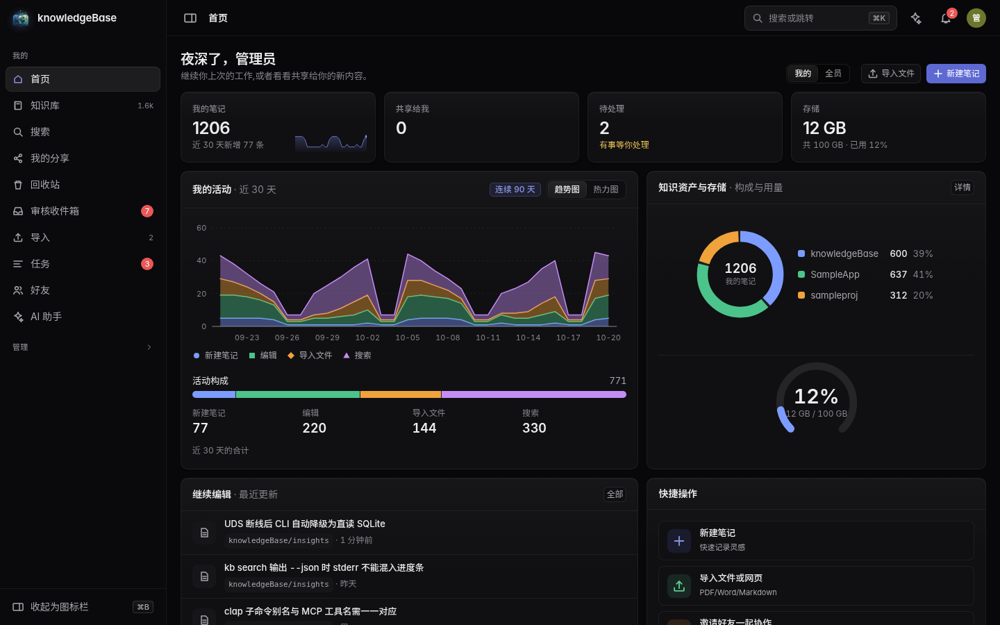
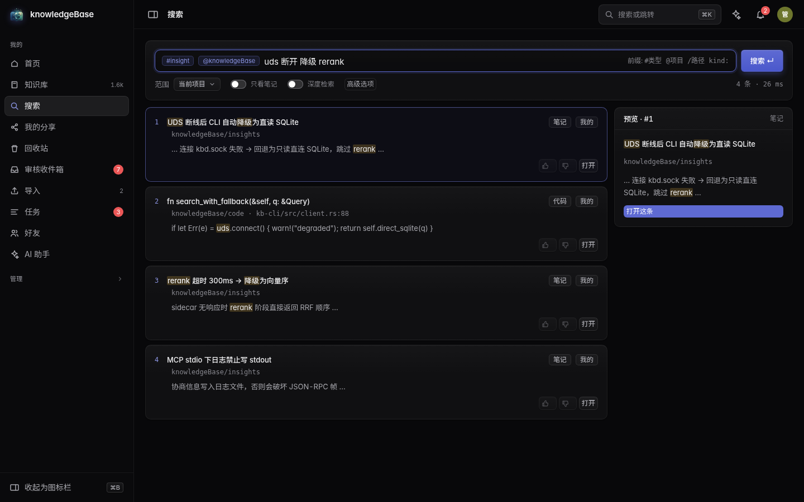
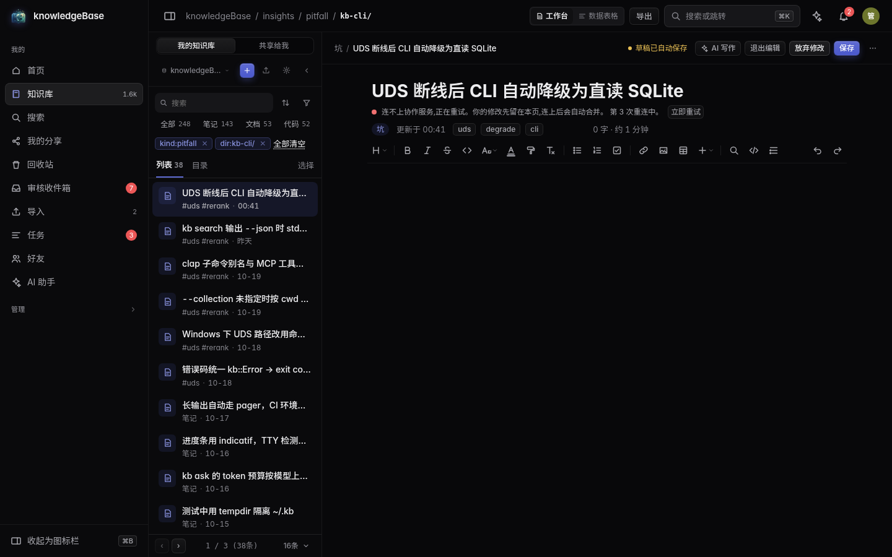
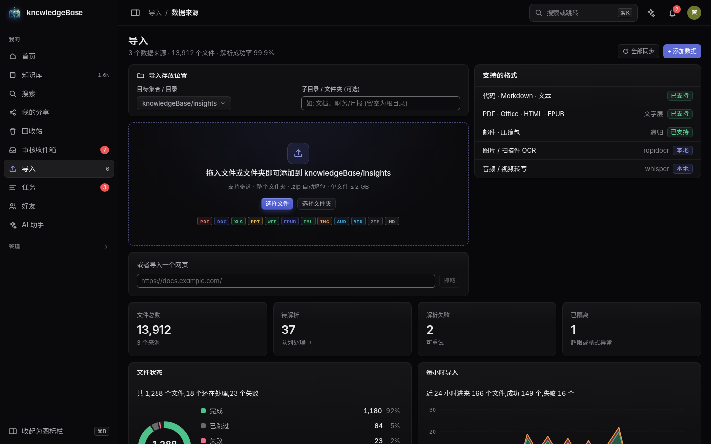
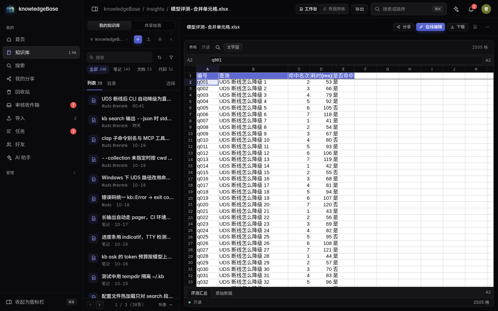
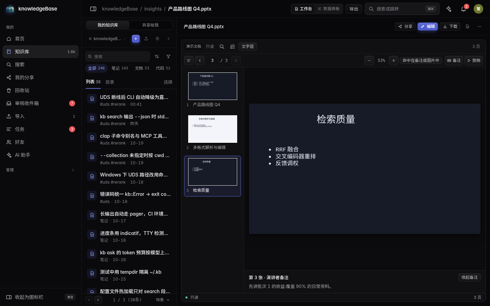
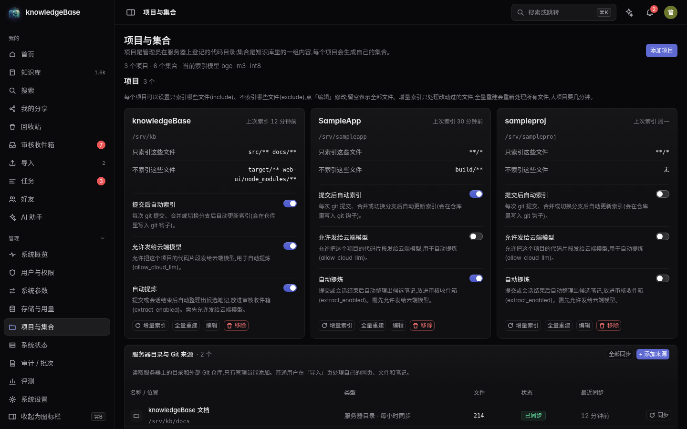
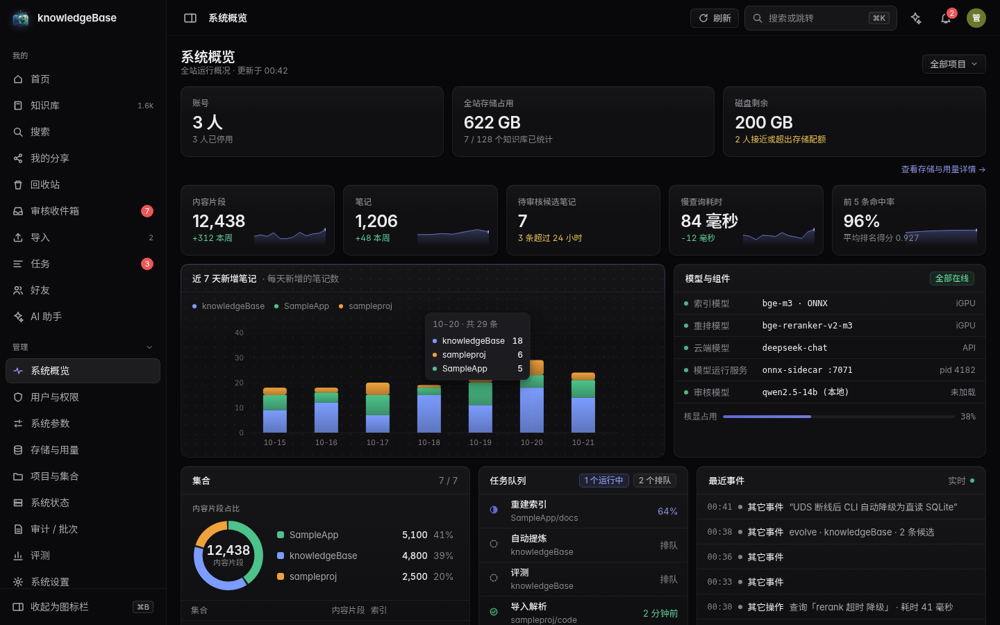
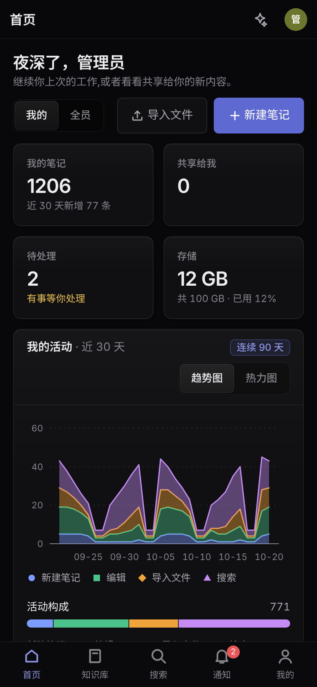

<p align="center">
  
</p>

<p align="center">
  <a href="README.md">简体中文</a> · <a href="README.en.md">English</a>
</p>

<h1 align="center">knowledgeBase</h1>

<p align="center">
  <strong>本机 AI 开发知识库</strong><br/>
  Rust 守护进程 + MCP + Vue 3 管理端
</p>

<p align="center">
  <a href="LICENSE"></a>
  
  
  
</p>

把代码、文档、经验条目索引成可检索的知识库,经 MCP 接给 Kiro / Claude Code / Codex 等 AI 工具,
再用一个可鉴权的 Web 管理端管理、浏览、编辑与评测。

> 本仓库只公开**源码**,不提供公共托管服务;线上实例由作者私有运行。
> 许可证为 PolyForm Noncommercial 1.0.0:允许个人与非商业用途,禁止商业使用,详见 [LICENSE](LICENSE)。

## 界面预览

> 截图由公开测试夹具生成,数据均为示例。

<table>
  <tr>
    <td width="50%" align="center"></td>
    <td width="50%" align="center"></td>
  </tr>
  <tr>
    <td align="center"><sub>首页 · 个人工作台</sub></td>
    <td align="center"><sub>搜索 · 混合检索与 RRF 解释</sub></td>
  </tr>
  <tr>
    <td width="50%" align="center"></td>
    <td width="50%" align="center"></td>
  </tr>
  <tr>
    <td align="center"><sub>知识库 · 在线编辑与关系面板</sub></td>
    <td align="center"><sub>导入 · 数据来源</sub></td>
  </tr>
</table>

<details>
<summary>更多截图：Office 预览、项目与集合、管理端总览、移动端</summary>

<table>
  <tr>
    <td width="50%" align="center"></td>
    <td width="50%" align="center"></td>
  </tr>
  <tr>
    <td align="center"><sub>Excel 预览</sub></td>
    <td align="center"><sub>PowerPoint 预览</sub></td>
  </tr>
  <tr>
    <td width="50%" align="center"></td>
    <td width="50%" align="center"></td>
  </tr>
  <tr>
    <td align="center"><sub>项目与集合</sub></td>
    <td align="center"><sub>管理端 · 系统概览</sub></td>
  </tr>
</table>

<p align="center">
  
</p>
<p align="center"><sub>移动端首页</sub></p>

</details>

## 核心能力

- 检索:LanceDB(向量 + 内置 BM25)+ FastEmbed,混合检索按 RRF 融合,中文用 jieba 分词
- 索引:tree-sitter 代码分块、Markdown / 纯文本 / PDF / Office(docx·xlsx·pptx)/ ODT / RTF / HTML / EPUB / 邮件 / 压缩包抽取;旧格式 Office(doc·xls·ods)装了 LibreOffice 后也能搜(见下面「旧格式 Office」)
- 进化:git hook / 会话事件触发的自动提炼 → LLM 审核 → 转正
  (`evolution.review_mode` 默认 `ai` 直接转正;`ai_then_human` / `human` 进审核收件箱等人工确认)
- 管理端:首页(个人工作台)、知识库、搜索、审核收件箱、导入(导入记录与数据来源)、任务、AI 助手;管理组里有系统概览、用户与权限、系统参数、存储与用量、项目与集合、系统状态、审计与批次、评测、系统设置

## 目录

- [界面预览](#界面预览)
- [核心能力](#核心能力)
- [安装](#安装)
- [快速开始](#快速开始)
- [接入 AI 工具(MCP)](#接入-ai-工具mcp)
- [配置](#配置)
- [备份](#备份)
- [多用户](#多用户)
- [文档](#文档)
- [开发](#开发)
- [许可证](#许可证)

## 安装

需要 Rust 1.91+(仓库 `rust-toolchain.toml` 锁 1.99.1)、Node.js 22+(前端构建与 office-worker)、`g++`(链接需要 libstdc++)、`protobuf-compiler`、`pkg-config`、`libssl-dev`。

```bash
git clone https://github.com/dada1212121121/knowledgeBase.git && cd knowledgeBase
cd web-ui && npm ci && npm run build && cd ..
cargo build --release            # 冷编译 25–35 分钟;没有 dist 也能编过,页面会提示先构建前端
export PATH="$PWD/target/release:$PATH"
kb doctor       # 环境自检:目录、磁盘、内存、核显、模型缓存、代理
```

模型缓存在 `~/.cache/kb-models`(BGE-M3 等),首次使用会从 Hugging Face 下载;
本机已有缓存时 `config.toml` 里把 `[embed] models_dir` 指过去即可,不要重复下载。

```bash
kb daemon                        # 前台运行;--detach 转后台
# 另开一个终端(密码只能经 UDS 设置,所以守护进程要先起来):
printf '%s\n' '你的密码' | kb auth set-password
```

Web 端默认监听 `127.0.0.1:7878`(见 `[server] listen`),浏览器打开后用上面的密码登录。

### 用 systemd 托管

```bash
kb service install               # root 装系统级,普通用户装用户级(--user 作用域)
kb service status
kb service uninstall
kb service install --print       # 只打印 unit,不落盘
```

unit 里带 `Restart=on-failure` 与 `Environment=NO_PROXY/no_proxy`(直连名单见 `[network]` 的说明)。

### Docker(可选)

```bash
docker build -t knowledgebase:dev .
docker run -d --name kb -p 7878:7878 -v kb-data:/data knowledgebase:dev
# 首次启动后设置 Web 登录密码(从标准输入读取):
docker exec -it kb kb auth set-password
```

镜像以非 root(UID 10001)运行,数据落在 `/data`;入口脚本只在 `/data/config.toml` 不存在时
生成监听 `0.0.0.0:7878` 的配置,挂载自己的 `config.toml` 即可完全接管。镜像只包含核心守护进程与
Web 界面;Word / Excel / PowerPoint 协同所需的 `office-worker` 不在镜像内,需要时请按
[docs/PLUGINS.md](docs/PLUGINS.md) 自行安装。

## 快速开始

```bash
kb project add /srv/workspace/myproj      # 注册项目(自动建 collection 并投递全量索引)
kb jobs                              # 看索引进度
kb search "UDS 断线怎么降级"          # 混合检索
kb eval                              # 用黄金集评测(默认 eval/golden.example.toml)
```

## 接入 AI 工具(MCP)

```bash
kb integrate kiro                    # 只打印配置片段
kb integrate claude --apply          # 写进客户端配置
kb integrate codex --apply
```

MCP 有两种传输:`kb mcp`(stdio,给本地客户端拉起来)与 `/mcp` HTTP 端点(需要 Bearer 令牌,
用 `kb auth token create` 生成)。MCP 面暴露 16 个工具,分四组:

- `knowledge`:`search_knowledge`、`search_code`、`get_item`、`list_collections`、`list_projects`、`agent_history`(只给本机 stdio 与 ACP 伴生;远程 `/mcp` 与 Bearer 令牌看不到它)
- `jobs`:`job_list`、`list_ingest`、`reindex_project`
- `insight`:`save_insight`、`kb_feedback`
- `docs`:`doc_read`、`doc_edit`(读改在线文档)、`check_links`(链接体检)、`doc_links`(引用图谱)、`list_files`(找可引用的文件 / 模板)

ACP 代理默认只开 `knowledge`。写操作走能力的权限与批次/撤销机制;管理级能力只在浏览器会话和本机 `kb.sock` 上开放。

## 旧格式 Office(doc · xls · ods)

这几种格式没有抽取器,默认只是原样保存、搜不到里面的字。装上 LibreOffice 并打开转换后,入库(上传和项目目录)时会
先转成 docx / xlsx 再抽取文字,**原文件一个字节都不动**,转换产物用完即删。

```bash
kb convert install               # 把锁定版本的官方整包(约 220 MB)装进 <KB_HOME>/bin/libreoffice-<版本>/,不改系统、不要 root
kb convert install --from /path/LibreOffice_26.2.6_Linux_x86-64_deb.tar.gz   # 离线安装,同样核对 SHA-256
kb convert status                # 看装了没有、是什么版本、转换开关
```

```toml
[convert]
enabled = true                   # 默认 false;改了要重启
timeout_secs = 120               # 单个文件的转换时限,超时强制结束
max_concurrent = 1               # 全站同时转换几个(每个进程峰值约 320 MB 内存)
```

`deploy.sh` 在 `config.toml` 的 `[convert]` 里已经 `enabled = true` 时会自动调用 `kb convert install`(已经装好就只核对一遍),
装不上不挡部署;`SKIP_CONVERT=1` 跳过。转换失败(文件损坏等)的文件记成「跳过」并写明原因,内容不变不再重试;
超时、转换器起不来这类暂时的失败会在下次扫描时重试。ppt / odp / wps / et / dps 没有真实样本验证过转换质量,不转换。
设置页「存储与索引 → 旧格式文档转换」可以改开关、时限和并发数。

## CSV / TSV 表格编辑

知识库里打开 `.csv` / `.tsv`,点「表格编辑」:像表格一样改格子、删行、加行,保存只提交改动。**保持原来的编码**(UTF-8、带 BOM 的 UTF-8、UTF-16、GBK / GB18030)、
分隔符(逗号、分号、制表符、竖线按内容判断)、引号写法、换行(CRLF / LF / CR)和末尾有没有换行,没改的字节一个都不动;不改直接保存,文件逐字节不变。
解不开(不是上面这几种编码)或解开再编码得不到原字节的文件会被拒绝并说明原因,不会冒险写回。保存带版本号和内容哈希的乐观锁:
别人在你打开之后保存过,或文件在磁盘上被别的程序改了,这次保存会被拒绝、你的草稿不丢。每次保存生成一个版本(基线是改动前的真实内容),
版本恢复也按原编码写回;只重新嵌入改动那几行所在的块。能力名 `csv_read` / `csv_edit`,权限同文本编辑(`docs.edit_text`)。
超过 32 MB 的文件请下载后用 Excel 编辑。

## 多人在线编辑

笔记、Markdown 文件(`.md`)、代码 / 文本文件、CSV / TSV 表格、Word / Excel / PowerPoint 都能多人同时编辑:大家的修改实时互见,
看得到别人的光标和名字,不用点保存(停手两秒自动存回原文件,改动之前的内容留在版本历史里)。
能不能编辑、能不能只看,按文档的授权来(所有者、分享给你的人;只能查看的人实时看到别人的修改,但改不了)。

**Word / Excel / PowerPoint**(知识库里打开**上传的** `.docx` / `.xlsx` / `.pptx`,点「在线编辑」):

- 编辑器是浏览器里的 WebAssembly,首次打开时才下载:xlsx 约 7.6 MB、pptx 约 6.3 MB、docx 约 34 MB(解压后大小)。
  构建时已做 brotli 预压缩,实际下发约 2.0 / 1.6 / 8.1 MB;字体另算:pptx 约 1.6 MB,docx 首屏只下文档里用到的字形(核心字体 + 用到的字形包),全部补齐后约 2.3 MB 中文 + 约 0.4–1.3 MB 拉丁(中文用 Noto Sans SC 的 GB2312 裁剪版;
  Word 只内置 Calibri / Arial / Times New Roman 的常规与粗体,其余字体和繁体 / 韩文的处理见下面)。都带内容哈希,可长期缓存。反向代理自己加 CSP 的话,`script-src` 要允许 `'wasm-unsafe-eval'`,`connect-src` 要允许 `'self'` 和 `data:`(Word 编辑器在后台线程里用 `fetch("data:…")` 解码文档里的图片,不放行的话图片位置会是一片空白,而且浏览器页面里看不到任何报错)。
  Word 的分页预览不下载这些引擎(约 40 KB);PowerPoint 的幻灯片预览改用同一个引擎画布渲染(预设形状、自动编号、渐变、图表不再静默缺失),
  首次打开多下约 2.1 MB(WASM 1.6 MB + 拉丁字体 0.4 MB,brotli),deck 里有中文时再多约 1.2 MB 的中文字体;引擎起不来或文件打不开时退回文字层(带重试入口)。
  PowerPoint 的在线编辑和多人协同也走同一个幻灯片面:改文字(含中文输入法)、拖动 / 缩放形状、插入文本框 / 形状 / 图片、替换图片、层级、多选对齐 / 分布、
  演讲者备注、新建 / 复制 / 删除 / 移动幻灯片、撤销重做;协同时缩略图标出谁在看哪一页、画布上给对方选中的形状画带名字的框。
  引擎暂不支持的(组合 / 取消组合、连接线、插入表格、表格增删行列)按钮是灰的,点一下会说明要用 PowerPoint 做。
  旧的 React 编辑岛和 pptx-preview 已在编辑器重构中删除,地址里的 `?editor=` 参数不再起作用。
- 服务端有一个按需启动的协同进程(`office-worker`,Node 22),和浏览器用同一版本的引擎持有一份副本,负责同步和存盘;
  没有人编辑 5 分钟就自己退出。`deploy.sh` 会在 `office-worker` 目录里装好它的依赖;装不上、或者 `[office] collab = false`、
  或者表格超过 1.5 MB(引擎协同的上限),就退回一个人编辑:同一时间只有一个窗口能改,别人只读并看到是谁在改,可以确认后接手。
- 打开时先检查编辑器能不能无损处理这份文档:文字没变、只是格式细节会被改写的,先只读并列出会变的部件,点「仍然编辑」才放开;
  文字对不上或文件不完整的,不能在线编辑。存盘前服务器再检查一次新文件是不是完整的 Office 包,不完整就拒绝,原文件不动。
- 有人在协同时,房间外的整文件替换(上传新版本、命令行替换、恢复旧版本)会被拒绝,不会盖掉大家正在改的内容。
- 旧版本留几份由 `[office] keep_versions` 决定(默认 3,0 到 50);一次协同(从有人打开到最后一个人离开)算一个版本。
- pptx 和 docx 的中文显示用 Noto Sans SC 的 GB2312 裁剪版(6763 个常用汉字 + 假名),GB2312 之外的生僻字、繁体独有字、韩文、阿拉伯文、希伯来文会显示成空框(文件内容不受影响,Word 里会提示)。
  Word 在线编辑只内置 Calibri / Arial / Times New Roman 的常规与粗体:这三个族的斜体显示成正体,Cambria、Courier New、Georgia、Segoe UI 等其余字体会改用 Carlito 显示并提示「分页可能与 Word 不同」。
  这是 dist 字体预算(12 MB)下的取舍;要补哪个字体、各占多大见 `web-ui/src/editor/engines/fonts/README.md`。
- 项目目录里的文件归代码仓库管,不在页面里改(下载后修改再上传)。旧格式(`.doc` / `.xls` / `.ppt`)不在线编辑。
- CSV / TSV 里不是 UTF-8(GBK / GB18030 / UTF-16)或超过 512 KB 的文件,在新表格里是按页向服务端取行的单人编辑:
  多人同时改靠保存时的版本检查(后保存的那位会被拒绝、草稿留在表格里)。
- 用中文输入法时,先双击格子 / 文字框 / 段落进入编辑再输入;Excel 里不双击、直接选中格子就敲拼音这条路径还没在真实输入法上验证过。

**AI 一起改**(MCP 工具 `doc_read` / `doc_edit`,上面所有格式都支持):

- `doc_read` 读文件或笔记现在的内容;有人正在编辑时读到的是大家正在改的版本。Word 每段一行,PowerPoint 按幻灯片分组,Excel 每格写成 `A1=值`。
- `doc_edit` 给 1–32 处「把原文换成新文字」,每处原文必须在读到的内容里恰好出现一次,整批生效或整批不生效。
- 默认 AI 只能提建议:文档页顶部出现「AI 提了 N 条修改建议」,人看过原文和新文字后接受或拒绝;接受时按当时的内容重新定位,对不上就标成失败、不改。
  设置 → 存储与索引 →「AI 直接修改文档」(`[office] agent_direct_edit = true`)打开后 AI 直接改。
- 有人正在编辑时,AI 的修改实时出现在每个人的编辑器里,不会把人踢出去,也不会盖掉别人刚敲的字;改动进版本历史(作者记成 `mcp:<客户端>`),可以恢复。
- AI 用的是调用者自己的权限:别人分享给你的文档,查看者只能读,编辑者才能改。AI 不能自己接受建议。

## 编辑器扩展

管理员可以把自己写的扩展(命令、工具栏按钮、斜杠菜单项、侧边面板、状态栏项、新格式的 Codec / 内容面、对选区调用的 AI 工具)放进 `<KB_HOME>/editor-extensions/<id>/`,在 `config.toml` 里打开 `[editor] extensions = true`(默认关,热更新)后,管理员的编辑器就会加载它们。扩展是在浏览器页面里运行的脚本,只加载本地可信目录里的,权限在 `manifest.toml` 里声明,`document.write` 首次使用要用户确认;**权限是 API 闸门,不是安全沙箱,只装读过代码的扩展**。示例 `web-ui/examples/editor-word-count/`(字数统计)与 `web-ui/examples/editor-todo-format/`(注册新文件格式 `.kbtodo`:装上后,文件浏览页里打开这种扩展名的文件会用扩展的内容面显示,有编辑权限时能改能存,保存走和文本文件同一条通道与版本检查;页面自己认得的格式永远优先),两者都可独立安装 / 卸载。编辑器自己的工具栏、导出、评论、AI 改写、字数也是用同一套扩展接口做的内置扩展。完整说明见 **[docs/EDITOR_EXTENSIONS.md](docs/EDITOR_EXTENSIONS.md)**。

```toml
[editor]
extensions = false           # 默认关;打开后只有管理员的浏览器会加载扩展
# extensions_dir = "..."     # 缺省 <KB_HOME>/editor-extensions;绝对路径或相对 KB_HOME(不含 ..)
```

## 外部编码代理(ACP)

管理端聊天走 ACP,不走内置大模型。设置 → 编码代理里安装代理;包装到 `<KB_HOME>/acp-tools`,不进系统全局 npm。

代理默认关在 bwrap 里:看不到 `run/kb.sock`,只能拿会话令牌连 `run/agent.sock`(写权限,工具组以 `acp.toml` 为准)。沙箱起不来时不会悄悄裸奔,除非把 `allow_unsandboxed` 设成 true,界面会标「未隔离」。改代理命令、关沙箱、装 npm 都是管理级,要在页面上确认。

内置模型仍负责提炼、审核、深度检索和主题归纳,在设置 → 模型里配置。

## 配置

`~/.kb/config.toml`(可用 `KB_HOME` 换根目录)。所有键都有默认值,只写要改的即可。

```toml
[server]
listen = "127.0.0.1:7878"

[embed]
backend = "fastembed"        # fastembed | http | fake
model = "bge-m3-int8"

[search]
k = 8
global_weight = 0.8          # _global 的 RRF 权重
collection_weights = {}      # 反馈调权写入的 per-collection 权重

[skills]
allow_exec = false           # 只允许声明式 skill
allow_unsandboxed = false    # bwrap 不可用时也不裸跑(默认);确认机器没有沙箱才打开

[backup]
enabled = true               # 守护进程每拍判断,到点才打包
interval_hours = 24          # 备份间隔(1..=720)
keep_count = 7               # 最多留几份(0 = 不按份数清理;最新一份永远保留)
keep_days = 0                # 超过多少天删掉(0 = 不按天数清理)
include_sources = false      # 定时备份是否带上原件(sources)
mirror_dirs = []             # 异地 / 外部存储目录(绝对路径,或相对 KB_HOME;最多 4 个)
```

配置补丁(`update_config`)是**合并语义**:只写要改的键;把某个键设成 `null` 表示删掉它(回到默认值)。

**热重载**:`config.toml` 改动 500ms 去抖后自动生效(检索参数、重排、调度、备份策略、日志级别、
`index.exclude`、MCP 输出上限、`[editor]` 编辑器扩展);`server.*` 等要重启;`embed.*` 不生效,只返回迁移计划。
换嵌入器的顺序是 **停服 → `kb migrate <collection> --to <新嵌入器>` → 启动**
(`kb migrate` 要拿 `run/daemon.lock`,守护进程在跑时会直接退出;Web 上会弹窗给出这几条命令)。
非法配置整份丢弃、保留旧配置,并通过 WS 推 `config.error`。

## 声明式 skills

`~/.kb/skills/<name>/manifest.toml`,三种类型(可执行脚本默认拒绝):

```toml
type = "loader-rule"          # 让 *.proto 走行窗口分块并打标签
[loader-rule]
glob = "**/*.proto"
lang = "text"
tags = ["proto"]
```

```toml
type = "prompt"               # 覆盖审核提示词
[prompt]
stage = "review"              # extract | review | web_extract
template = "只保留可执行的结论。"
```

```toml
type = "insight-template"     # 新建经验条目的必填与长度限制
[insight-template]
required = ["title", "body", "tags"]
max_body_chars = 4000
```

改完在 Web 端或能力层调 `reload_skills` 重扫,下一个文件/下一次调用即生效。
`prompt` 类型的覆盖在 `EvolutionService` 被构造的路径上生效,包括下面「会话 hook」触发的自动提炼。
`stage = "web_extract"` 整体替换下面「网页 AI 规范化」的统一提示词(下一页就生效,已整理的页面在下次同步时按新提示词重新整理)。

## 网页 AI 规范化

网页数据源抓到的页面除了原文照常入库,还可以交给内置模型整理成一份结构固定的结果(摘要、要点、关键信息、
正文结构、表格、代码、涉及对象、相关链接),渲染成 Markdown 一起入库,检索时用 `tag:ai-extract` 只看或排除它们。

- **开关**:添加网页来源时的「AI 规范化」,来源详情里可改;新建时的默认值是 `[web_extract] enabled_by_default`。
  迁移前已有的网页来源默认关。要有「自动提炼与审核」(`ai.extract`)功能点。
- **提取要求**:留空 = 模型自动判断页面类型、尽量全面地整理;个别网站可以写清要什么(例如「只要产品名称、价格、
  规格参数」),专门要的内容出现在结果的「按要求提取」一节,其余字段照常填。改了要求,下次同步时每页都按新要求重新整理。
- **花费**:在同步之后的后台任务里逐页调用模型(`[llm] extract_model`),外发同样走闸门:AI 开关、目标集合所属项目的
  `allow_cloud_llm`、脱敏、`max_calls_per_hour` / `daily_token_budget` 与个人 AI 额度。正文和提取要求都没变的页面不再调用。
  被闸门挡住或额度用完时暂停、不算失败,来源详情里写明原因,剩下的页下次同步补。每次同步最多整理
  `max_pages_per_sync` 页;超长页面按 `max_input_chars` 切段,最多 `max_parts` 段。没有配置 API key 时不运行。
- **可信度**:结果头部写明来源与「由 AI 规范化,以原文为准」;结果里的链接必须是页面里真实出现过的地址,
  模型编的链接会被丢掉。页面从站点上消失后,下次同步会把原文和它的整理结果一起清掉。

```toml
[web_extract]
enabled_by_default = true
max_input_chars = 24000
max_parts = 4
max_pages_per_sync = 50
```

## 会话 hook

会话结束时把这一段对话交给提炼器,产出经验草稿(走审核收件箱):

```bash
# Claude Code:把命令挂到 SessionEnd hook 上(Stop 是每轮触发,建议绑 SessionEnd)
#   {"session_id": "...", "cwd": "/srv/workspace/xxx", "transcript_path": "..."} 从 stdin 传进来
kb hook claude-stop

# Kiro:会话记录在 ~/.kiro/sessions/cli/<id>.jsonl,stdin 里给 cwd(可选 session_id)
kb hook kiro-stop
```

- 前提:目标项目已打开 `extract_enabled` 与 `allow_cloud_llm`(两个都开才会外发)。
- **会话记录路径只接受本机 Unix socket 投递**:`POST /api/v1/events` 上的 TCP 身份(含 `scope=mcp`
  令牌)带 `session_path` / `transcript_path` 会得到 403;服务端还会校验路径必须是 `.jsonl`、
  不命中内置路径黑名单、且落在项目根或下面的目录里。
- 守护进程与 AI 客户端的 `HOME` 可能不同(生产上守护进程是 `HOME=/root`),所以**会话记录目录
  要显式配置**,默认值只是 `~/.claude` 与 `~/.kiro`:

  ```toml
  [evolution]
  session_roots = ["/root/.claude", "/root/.kiro"]
  ```

  改完是热更新,不用重启。目录不存在时日志里会有警告,那一类会话会被跳过。
- 同一份会话内容没变时不会重复提炼;绑在每轮的 `Stop` 上仍会每轮一次,成本由
  `[llm] max_calls_per_hour` / `daily_token_budget` 兜住。
- 项目根里名字不命中黑名单的 `.jsonl`(例如把 `.env` 复制成 `notes.jsonl`)仍可能被读并发给
  云端 LLM —— 路径黑名单看不到内容,只做模式脱敏。

## 反馈调权

Web 端对检索结果点「有用 / 无用」,反馈落 `feedback` 表。`tune_retrieval` 能力会按
collection 的有用率给出 RRF 权重建议(样本 ≥5、单次幅度 ≤0.2),确认后写进
`search.collection_weights` 并立即生效;应用前后各跑一次 `kb eval`,MRR 下降自动回滚。

## 备份

守护进程按 `[backup]` 定时打包 `<KB_HOME>` 里**丢了找不回来**的部分(`meta.db` 的
`VACUUM INTO` 一致性快照、多用户部署的账号库 `system.db` 与每个用户知识库的 `meta.db`、头像、`config.toml`、
`skills/`、`eval/`,原件可选),归档放在
`<KB_HOME>/backups/kb-<时间>.tar.gz`;**不备份**向量表与模型(重建索引即可恢复)与
`secrets.toml`(含 API key)。归档只增不减会把磁盘吃满,所以同一份 `[backup]` 也是
保留策略:超过 `keep_count` 份或 `keep_days` 天的旧归档会被删掉,最新一份永远保留。

**异地 / 外部存储**:`[backup] mirror_dirs` 里列出的每个目录都会拿到一份副本(移动硬盘 / NAS /
另一个数据盘),清理与删除也会同步过去。复制失败**不会**让这次备份失败(本机已经有一份),
但会进同一套告警 —— 外接盘没挂上不会静悄悄少一份备份。每份副本落盘后会**回读比对 sha256**,
对不上的副本会被删掉并记告警(异地目录里留着的都是验过的)。

**自动校验**:每份归档写完之后会自己跑一次 `kb backup verify` 那套检查(解压一遍、核对
`manifest.json` 与 `meta.db`),结论落在 `backups/.verify.json`,由 `kb backup list` 的「最近校验」、
`backup_status.last_check` 与设置页的「最近校验」行暴露 —— 不必人手点「校验」才知道这份备份能不能恢复。

```bash
kb backup create [--include-sources]   # 立即备份(按 mirror_dirs 复制到异地并回读比对,写完自动校验)
kb backup list                         # 归档、大小、定时备份、保留策略、异地副本状态、最近校验
kb backup verify kb-20261024-101500.tar.gz   # 校验归档(只读;恢复前先跑)
kb backup verify /mnt/usb/kb-backups/kb-20261024-101500.tar.gz   # 也能直接校验异地副本
kb backup prune [--keep 3] [--dry-run] # 按保留策略清理(含异地副本)
kb backup delete kb-20261024-101500.tar.gz
```

**恢复**要停服手工做(不提供破坏性的 `restore` 子命令):停守护进程 →
`kb backup verify` 校验 → 解包到临时目录 → 删掉旧的 `meta.db-wal` / `meta.db-shm` 再覆盖
`<KB_HOME>`(以 root 解包时加 `--no-same-owner`)→ 启动 → `kb doctor` 自检 → 重建索引
(向量表不在归档里)。完整步骤、回滚与常见问题见 **[docs/BACKUP_RESTORE.md](docs/BACKUP_RESTORE.md)**。

Web 端「设置 → 备份」是同一套能力,并有:打包进度条、失败告警(任意页面横幅 + 失败历史)、
异地副本卡片(每个目录几份、最新一份在不在、上次失败原因)、最近校验行、每行「校验」、
可一键复制的「恢复步骤」。
**打包、清理(`prune` / 删除)、异地复制、自动校验**四处失败都落 `backups/.failures.json`,
并各按“该环节之后成功一次”自动撤掉告警;删不掉的旧归档不再只留在页面提示与日志里。

## 多用户

同一个守护进程可以服务多个账号:每人一个**物理隔离**的知识库(自己的 SQLite、向量库、原件),
角色与功能权限、配额、AI 额度、好友与通知、文档级分享(查看 / 评论 / 编辑 / 管理)、
分享链接与游客、多人在线编辑、两步验证都在里面。从单用户版升级是**零操作**(旧密码变成管理员 `admin`)。

- 部署与管理:**[docs/MULTI_USER_ADMIN.md](docs/MULTI_USER_ADMIN.md)**(邮件、注册、角色、配额、AI、分享与游客、已知限制)
- 升级 / 回滚 / 备份恢复:**[docs/BACKUP_RESTORE.md](docs/BACKUP_RESTORE.md)** §7,演练脚本 `scripts/rehearse-upgrade.sh`
- 设计与取舍:**[ARCHITECTURE.md](ARCHITECTURE.md)**、**[FEASIBILITY.md](FEASIBILITY.md)**

## 常见问题

**模型下载很慢 / 卡住**:`huggingface.co` 走代理,`crates.io` 与模型源建议直连;
`config.toml` 与 systemd unit 里的 `NO_PROXY` 已按本机实测写好(见 [FEASIBILITY.md](FEASIBILITY.md) 的部署说明)。
不要设置 `HF_ENDPOINT=https://hf-mirror.com`(fastembed 会报 `Content-Range missing`)。

**端口被占**:改 `[server] listen`,或 `kb daemon` 前先 `kb doctor` 看 socket 与端口状态。

**索引很慢 / 磁盘涨得快**:LanceDB 累计写入 2000 行后 optimize 一次(`index.optimize_after_rows`);`target/` 与 `~/.kb/lance/`
是主要占用。测试二进制很大时 `cargo clean` 或删 `target/debug/deps` 里的旧产物。

**换嵌入模型**:`kb migrate <collection> --to <embedder>` 先 dry-run 估算,再执行;
它会新建表、复制、对账后切换 `active_table`,旧表保留用于回滚。

**没有 API key**:LLM 相关能力(提炼、审核、深度检索、AI 助手)在无 key 时走 mock,
只验证链路不产出真实结果;真实调用需要 `~/.kb/secrets.toml` 的 `[llm] api_key`。

## 数据位置

```
~/.kb/
├── config.toml
├── meta.db                 SQLite(项目 / collection / 条目 / 任务 / 反馈)
├── lance/                  LanceDB(向量列 + 全文列)
├── skills/                 声明式 skills
├── lang/jieba/             中文词典
├── eval/                   黄金集与评测历史
├── backups/                备份归档(定时备份 + 保留策略)
└── logs/ run/              日志与 socket / 锁
```

## 开发

```bash
source scripts/env.sh                  # 代理与 cargo 环境
scripts/install-hooks.sh               # 安装 pre-push 快速验收钩子
scripts/verify.sh --fast               # 三分钟档:格式 / 架构门禁 / Clippy / 核心测试 / 前端 lint + tsc
scripts/verify.sh --full               # 全量:再加 Rust 全量测试、vitest、serve.mjs、无 dist 的 kb-web 编译
cargo test -p kb-service               # 按 crate 跑
cargo clippy --workspace --all-targets -- -D warnings
cd web-ui && npm ci && npm run build && npm run lint && npm run test
cd web-ui && node e2e/editor-bench.mjs     # 编辑器性能基线(5 个阅读样本 + 3 个编辑态,数字由脚本直接输出)
cd web-ui && node e2e/editor-native.mjs --surface=docx-read   # 统一外壳的阶段门禁;--surface 可选 text / code / pdf / csv / xlsx-read / xlsx / docx-read / docx / pptx-read / pptx
cd web-ui && node e2e/editor-pptx-edit.mjs     # PPTX 编辑 e2e(输入法 / 拖动 / 保存字节 / 10+ 份 deck 不改保存 / 崩溃恢复…)
cd web-ui && node e2e/editor-pptx-collab.mjs   # PPTX 协同 e2e(两个浏览器 + AI;用 office-worker 的真实房间逻辑,需要先在 office-worker 里装好依赖)
cd web-ui && node e2e/sweep.mjs        # 跨视口巡检(横向滚动 / 溢出 / 重叠)
cd web-ui && node e2e/clipcheck.mjs    # 被裁掉且滚不到的内容
cd web-ui && node e2e/axe.mjs          # 无障碍(axe-core):critical + serious 必须为 0
```

`npm run build` 结束时会给 js / css / wasm / 字体生成 `.br` / `.gz` 预压缩文件(`web-ui/scripts/precompress.mjs`,按内容缓存,首次约 1 分钟),
`scripts/serve.mjs` 与守护进程内嵌的静态资源按 `Accept-Encoding` 直接发它们;只想快速看页面时 `KB_PRECOMPRESS=0 npm run build` 跳过。

编辑器已按内容区域换成统一外壳(`web-ui/src/editor/`):笔记 / Markdown(含选区批注、管理员巡检)、代码文件、PDF、CSV / TSV、Word 预览、Excel 与 PowerPoint 的预览 / 编辑 / 协同默认都走新实现;Word 在线编辑的新画布(`docxEdit`)用 `?editor=next` 试用。
旧实现(Milkdown 笔记编辑器、React 办公编辑岛、旧 CSV 编辑器、pptx-preview、md-editor-v3)已在编辑器重构中全部删除,`?editor=` 参数不再起作用;
紧急回退靠上一版本的构建 / 镜像,不靠仓内旧代码;取舍与验证记录见提交历史。
CSV 表格编辑在新外壳里按文件挑数据源:UTF-8 且不超过 512 KB 的整份读进浏览器(有多人编辑房间时借用房间文本);
超过 512 KB 或不是 UTF-8(GBK / GB18030 / UTF-16)的按页向服务端取行、保存时提交操作列表,由服务端按原编码逐字节写回。
右键行号或用工具栏可以在选中行的上方 / 下方插入行、删除选中的行;新插入的空行填了内容才写进文件。

设计:[ARCHITECTURE.md](ARCHITECTURE.md)(架构设计)、[FEASIBILITY.md](FEASIBILITY.md)(可行性实测)。

## 文档

| 文档 | 内容 |
|---|---|
| [使用指南](docs/guide/USER_GUIDE.md) | 首次登录、导入、检索、编辑、分享与 MCP 的完整使用说明 |
| [MCP 接入](docs/INTEGRATION.md) | Kiro / Claude Code / Codex 的配置与工具说明 |
| [多用户管理](docs/MULTI_USER_ADMIN.md) | 账号、角色、配额、AI 额度、分享与游客 |
| [备份与恢复](docs/BACKUP_RESTORE.md) | 定时备份、异地副本、校验、恢复与回滚 |
| [编辑器扩展](docs/EDITOR_EXTENSIONS.md) | 命令、工具栏、Codec、内容面与 AI 工具扩展 |
| [插件](docs/PLUGINS.md) | 插件目录、清单与权限 |
| [架构设计](ARCHITECTURE.md) | 分层、数据模型、检索链路与关键取舍 |
| [可行性实测](FEASIBILITY.md) | 关键依赖、性能与部署环境的实测记录 |
| [发布流程](docs/RELEASING.md) | 版本、验收、发布物与打标签流程 |
| [变更记录](CHANGELOG.md) | 各版本对用户可见的变更 |
| [路线图](ROADMAP.md) | 当前重点与明确不做的事 |
| [获取支持](SUPPORT.md) | 文档入口、提问方式与支持范围 |

## 参与贡献

- 提交前请阅读 [CONTRIBUTING.md](CONTRIBUTING.md);
- 安全问题请按 [SECURITY.md](SECURITY.md) 私下报告,不要开公开 issue;
- 参与讨论即表示同意遵守 [CODE_OF_CONDUCT.md](CODE_OF_CONDUCT.md)。

## 许可证

本项目采用 **PolyForm Noncommercial License 1.0.0**:允许个人学习、研究、非商业项目使用、修改与分发,
**禁止任何商业用途**。完整条款见 [LICENSE](LICENSE)。

版权归个人作者所有。第三方组件、字体与词典的许可见 [NOTICE](NOTICE) 与 [THIRD_PARTY_LICENSES.md](THIRD_PARTY_LICENSES.md)。
本项目只以源码形式发布,不提供、也不授权任何官方托管服务。

**这是 OSI 定义的开源许可证吗?** 不是。PolyForm Noncommercial 属于 source-available:源码可以阅读、修改、
自部署与非商业分发,但不满足 OSI 对“允许任何用途”的要求。选择它是因为本项目明确禁止商业使用;
如果你需要商业授权,请先联系维护者。
