# knowledgeBase 使用指南 {#top}

这份指南写给**普通用户**,不需要会写代码。它回答四个问题:

1. 怎么创建**访问令牌**(给其它程序用的密钥);
2. 怎么用 **MCP** 把知识库接进 Kiro、Claude Code、Codex 等客户端,以及 MCP 提供哪些工具;
3. 除了 MCP,还有哪些接入方式;
4. 怎么把新内容放进知识库、怎么更新、怎么查看进度。

> **提示** 文中带尖括号的是需要你替换的占位符,例如 `https://<你的知识库地址>`、`<你的令牌>`。截图里的名字、令牌和数据都是示例,不是真实数据;截图上的红色编号对应图注里的 ①②③。

> **提示** 有些入口只有开通了对应功能的账号才看得到(例如「访问令牌」需要「API 令牌与 MCP」功能)。看不到时不是你操作错了,请联系管理员为账号开通。

## 1. 快速开始 {#quick-start}

第一次使用,按下面五步走:

1. **登录。** 用管理员给你的用户名和密码登录。第一次登录建议立刻到「个人设置」修改密码,并开启两步验证(见 [第 2 节](#account))。
2. **放进第一批内容。** 打开左侧「导入」(手机:底部「我的」→「导入」),把文件拖进去,或点「选择文件」(见 [第 7 节](#update-data))。
3. **看进度。** 在「导入」页的「导入记录」里,每个文件会依次经过排队、解析、分块、向量化,直到显示「成功」。
4. **搜索。** 打开「搜索」,用一句话描述你要找的东西,不需要记得原文。
5. **接给其它程序用。** 在「个人设置」创建一个访问令牌(见 [第 3 节](#tokens)),再按 [第 4 节](#mcp) 配置你的客户端。

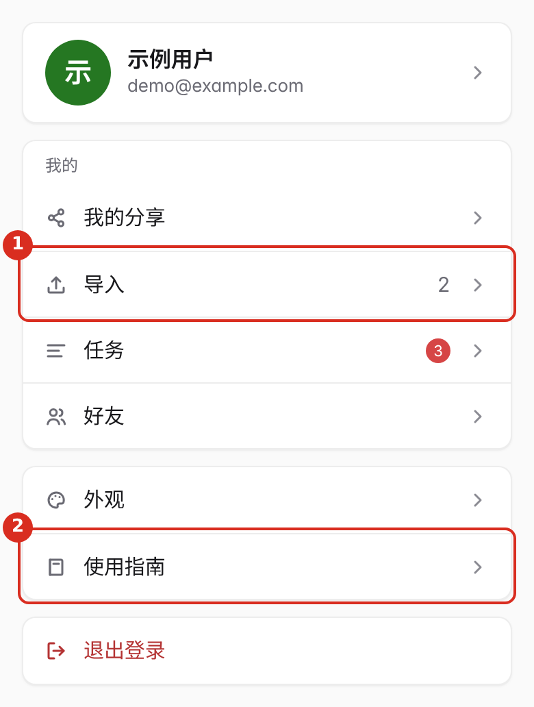

**电脑和手机的区别。** 电脑上左侧有导航栏;手机上只有底部的「首页 / 知识库 / 搜索 / 我的」四个标签,其余入口都从「我的」进入,左上角的返回键回到「我的」。

## 2. 登录与个人设置 {#account}

点右上角的头像,选「个人设置」(手机:「我的」→ 顶部的账号卡片)。这一页管理你自己的账号:

- **修改密码。** 修改后,你在其它设备上的登录会全部退出,当前设备保持登录。
- **我的用量。** 显示已用存储。超出配额后不能再上传或新建内容,已有内容仍可查看和删除;删掉不用的文件后会自动恢复,也可以联系管理员调高配额。
- **两步验证。** 用验证器(手机上生成 6 位验证码的 App)给账号再加一道锁。
- **访问令牌。** 给其它程序用的密钥,见下一节。
- **登录设备。** 能看到都有哪些设备登录着你的账号,并可以退出其它设备。

## 3. 创建访问令牌 {#tokens}

**访问令牌**是给其它程序(MCP 客户端、你自己的脚本)用的密钥。程序带着它访问知识库时,看到的就是**你自己的**知识库,权限也不会超过你的账号。服务器只保存令牌的指纹,**明文只在创建时显示一次**。

### 3.1 找到入口 {#token-entry}

「个人设置」页往下找「访问令牌」卡片。卡片里列出你已有的令牌;一个都没有时会提示「还没有访问令牌」。

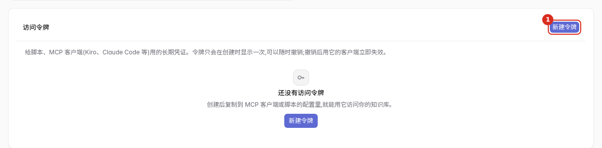

> **提示** 看不到这张卡片,说明账号没有开通「API 令牌与 MCP」功能。请联系管理员。

### 3.2 新建令牌 {#token-create}

1. 点卡片右上角的「新建令牌」。
2. **名称**(必填,最多 100 个字,同一个账号下不能重名)。写清楚给谁用,例如「kiro-笔记本」,以后撤销时好认。
3. **类型**,二选一:
   - **MCP**:给 Kiro、Claude Code、Codex 等 MCP 客户端连接知识库用;
   - **API**:给你自己的脚本调用网页接口用。
4. 选 MCP 时,还有一个开关「包含共享给我的内容」,**默认关闭**。开启后,用这个令牌连接的客户端也能搜到别人分享给你的内容,这些内容会进入客户端的对话上下文,所以默认不给。API 令牌用不到这个开关。
5. 点「创建令牌」。

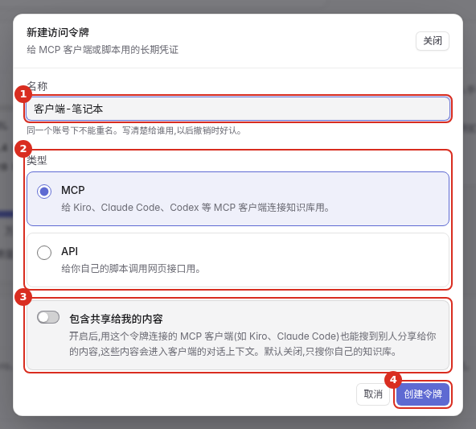

### 3.3 复制并保存令牌 {#token-copy}

创建成功后弹出「令牌已创建」,里面是以 `kb_` 开头的一长串字符。

1. 点「复制令牌」。
2. 马上粘贴到你的客户端配置或密码管理器里。
3. 点「完成」。如果你还没复制就点「完成」,系统会先提醒一次,再点才真正关闭。

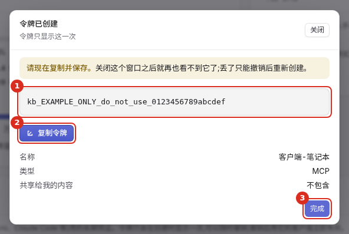

> **注意** 关闭这个窗口之后就再也看不到明文了,服务器也找不回来。丢了只能撤销旧令牌,再新建一个。

### 3.4 两种类型有什么区别 {#token-scopes}

| | MCP 令牌 | API 令牌 |
|---|---|---|
| 用在哪 | 客户端连接 `/mcp`(第 4 节) | 脚本调用网页接口(第 5 节) |
| 能做什么 | 只能用 MCP 提供的那几个工具,权限最高到「写」 | 能调用网页界面用到的大部分能力,权限最高到「治理」 |
| 「包含共享给我的内容」 | 可选 | 不适用 |

两种令牌都**不能**做管理级的事(改系统设置、管理令牌等)。管理级操作只允许在浏览器里登录后进行。令牌也不能用来创建或撤销别的令牌。

> **注意** 类型要和用途对上。拿 API 令牌去连 `/mcp` 会被拒绝(401,提示「这个令牌的 scope 不是 mcp」)。

### 3.5 查看与撤销 {#token-revoke}

卡片里的表格列出每个令牌的:名称、类型、是否包含共享给我的内容、创建日期、最近使用,以及状态(「有效」或「已撤销」)。从没用过的令牌「最近使用」显示「从未使用」。

撤销:点那一行的「撤销」,在确认框里再点一次「撤销」。**撤销立即生效,不能恢复**:正在用它的客户端或脚本马上失去访问权限。需要的话只能重新创建一个。

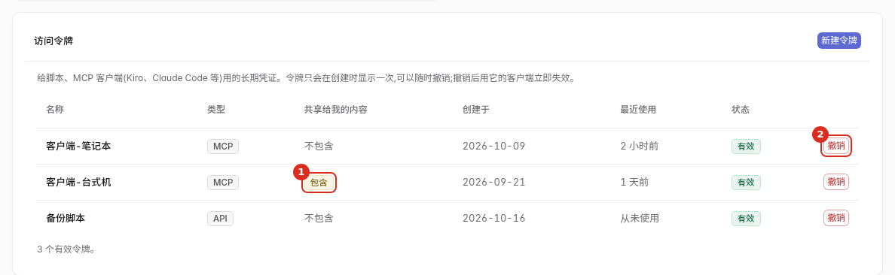

### 3.6 安全习惯 {#token-safety}

- 令牌等同于密码。不要贴进聊天、工单、截图或代码仓库。
- **一个客户端一个令牌**,名字写清楚。这样某台电脑丢了,只需要撤销它那一个。
- 怀疑泄露,或者不再使用某个客户端了,立刻撤销。
- 令牌建好后不能修改类型或开关。要改就撤销后重新创建。

## 4. 用 MCP 连接客户端 {#mcp}

**MCP** 是一种让客户端(Kiro、Claude Code、Codex 等)把知识库当工具来调用的协议。接好之后,你可以直接在客户端里说「去知识库里查一下……」,它会自己调用下面的工具。

### 4.1 两种连接方式 {#mcp-modes}

| | 本机连接(stdio) | 网络连接(HTTP,`/mcp`) |
|---|---|---|
| 适合谁 | 客户端和知识库服务**在同一台机器**上 | 客户端在你自己的电脑上,知识库在服务器上 |
| 需要令牌吗 | 不需要,以本机身份运行 | **需要** MCP 类型的访问令牌 |
| 谁来开启 | 默认可用 | 管理员(默认关闭) |

多数普通用户用的是第二种:知识库部署在服务器上,你在自己的电脑上配置客户端。

### 4.2 网络连接需要什么 {#mcp-http}

先确认三件事:

1. **管理员已经开启 `/mcp`。** 它默认关闭,打开方式是在服务端的 `config.toml` 里写 `[mcp]` 的 `transports = ["stdio", "http"]`,然后重启服务。没开时访问 `/mcp` 得到 **404**,请把这一点告诉管理员。
2. **如果服务经过反向代理暴露在域名上,** 管理员还要把这个域名加进 `mcp.allowed_hosts`(服务会校验 `Host`,防止 DNS 重绑定攻击),否则连接会被拒绝。
3. **你有一个 MCP 类型的访问令牌**(第 3 节)。

连接信息只有两项:

```text
地址:  https://<你的知识库地址>/mcp
请求头: Authorization: Bearer <你的令牌>
```

客户端的 `Accept` 请求头建议带上 `application/json, text/event-stream`。

### 4.3 客户端配置 {#mcp-config}

支持「地址 + 请求头」写法的客户端,在它的 MCP 配置里加一项。系统自己给出的片段(管理员可在「系统设置 → MCP 接入」里复制)长这样:

```json
{
  "mcpServers": {
    "knowledgeBase-http": {
      "url": "https://<你的知识库地址>/mcp",
      "headers": { "Authorization": "Bearer <你的令牌>" }
    }
  }
}
```

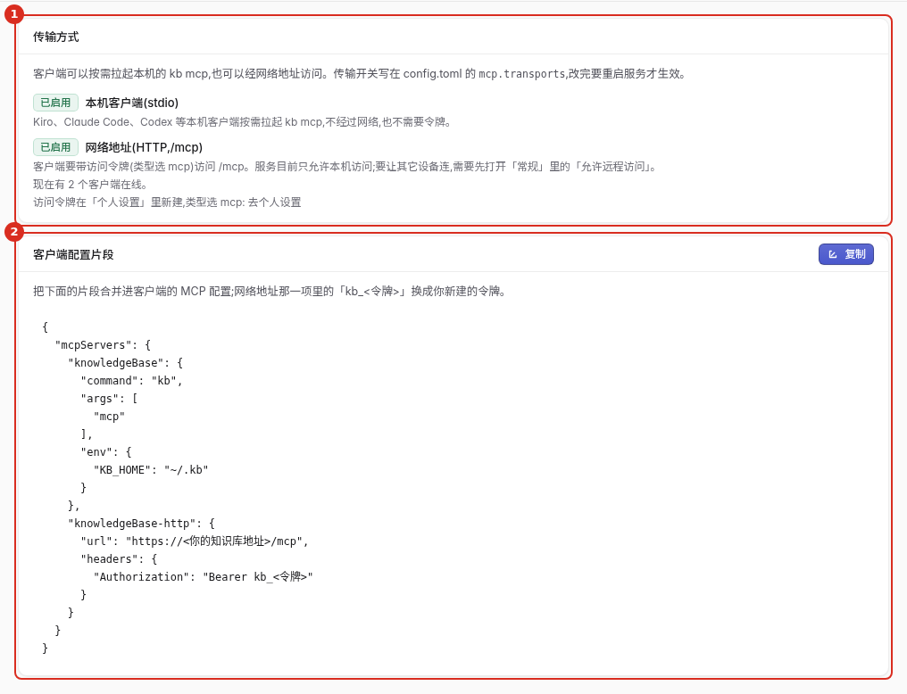

> **提示** 不同客户端的配置文件位置和字段名不完全一样。我们**只验证过**下面 4.4 的三种本机写法;网络写法在各个客户端里是否原样可用,请以客户端自己的文档为准(未验证)。Cursor、Gemini CLI 的配置方式同样未验证。

### 4.4 本机连接:Kiro、Claude Code、Codex {#mcp-local}

这一节只适用于**客户端和知识库服务在同一台机器**上(例如部署知识库的服务器本身,或你自己的开发机上装了 `kb`)。客户端会按需拉起 `kb mcp`;如果守护进程没在运行,`kb mcp` 会自动用 `kb daemon --detach` 把它启动起来(最多等 60 秒)。

先用 `kb integrate <客户端>` 打印配置片段,确认无误后加 `--apply` 写入(写入前会先备份原文件,备份名带时间戳)。

**Kiro CLI**

```bash
kb integrate kiro            # 只打印
kb integrate kiro --apply    # 合并进 ~/.kiro/settings/mcp.json,保留其它 server
```

```json
{ "mcpServers": { "kb": { "command": "kb", "args": ["mcp"], "timeout": 120000 } } }
```

**Claude Code**(它自己管理配置文件,用它的命令添加)

```bash
claude mcp add --scope user kb -- kb mcp
```

**Codex**

```bash
kb integrate codex --apply   # 追加 [mcp_servers.kb] 到 ~/.codex/config.toml
```

```toml
[mcp_servers.kb]
command = "kb"
args = ["mcp"]
```

只想让客户端用一部分工具时,加 `--features`,可选的工具组是 `knowledge`、`jobs`、`insight`(逗号分隔,默认全部)。例如 `kb mcp --features knowledge`。

### 4.5 MCP 提供的工具 {#mcp-tools}

MCP 客户端能用下面 16 个工具(`agent_history` 只在本机 stdio 连接里出现,网络 `/mcp` 看不到)。**读**不会改任何数据;**写**会新增或改动数据,并且走批次记录。

| 工具 | 用途 | 常用参数 | 权限 |
|---|---|---|---|
| `search_knowledge` | 混合检索(全文 + 语义),查知识库里的内容 | `query`(必填);`scope`:`project` / `global` / `all`;`kinds`;`k`(条数);`lang`;`path_prefix` | 读 |
| `search_code` | 只在代码块里检索,相当于 `search_knowledge` 加 `kind:code` | 同上 | 读 |
| `get_item` | 按 id 取一条记录的完整内容 | `id`(必填);`context_lines`(多带几行上下文) | 读 |
| `list_collections` | 列出集合:名称、种类、行数 | 无 | 读 |
| `list_projects` | 列出已登记的项目:根目录、块数、上次索引时间 | 无 | 读 |
| `job_list` | 列出后台任务 | `state`(只看某个状态) | 读 |
| `list_ingest` | 分页看导入记录:状态、块数、耗时、失败原因 | `collection`;`batch_id`;`state`;`page`;`page_size`(最大 200) | 读 |
| `save_insight` | 把一条经验存成笔记 | `title`、`body`(必填);`kind`;`tags`;`related_paths`;`global` | 写 |
| `kb_feedback` | 对某条检索结果打「有用 / 无用」 | `query`、`item_id`、`useful`(必填);`note` | 写 |
| `reindex_project` | 重新索引一个项目 | `project`(必填);`mode`:`incremental`(默认)或 `full` | 写 |
| `agent_history` | 查编码代理的历史会话(只在本机 stdio 连接里) | `limit`;`project` | 读 |
| `doc_read` | 按行读一个文件或一篇笔记现在的正文 | `collection` + `path`,或 `note_id`;`offset`;`limit`(默认 400,上限 2000) | 读 |
| `doc_edit` | 按「原文换成新文字」改文件或笔记 | `collection` + `path`,或 `note_id`;`edits`(1–32 处);`reason` | 写 |
| `check_links` | 批量检查正文里的引用目标在不在 | `targets`:文件 `{collection, path}` / 笔记 `{note_id}`,最多 200 条 | 读 |
| `list_files` | 找一个已有文件或模板的准确路径来引用 | `collection`(必填);`path_prefix`;`q`;`page`;`page_size` | 读 |
| `doc_links` | 查一篇文档或笔记的出链、入链 | `collection` + `path`,或 `note_id`;`direction`:`from` / `to` / `both`;`limit` | 读 |

几点说明:

- 搜索支持在查询串里写前缀缩小范围:`kind:`、`lang:`、`path:`、`tag:`、`status:`、`since:`。`kind` 的取值是 `code`、`doc`、`insight`(笔记)、`external`、`summary`。
- `save_insight` 的 `kind` 可选 `decision`、`pitfall`、`howto`、`convention`、`note`;还可以用 `collection` 直接指定写进哪个集合。返回里的 `links` 是正文引用的解析结果。
- `save_insight` 默认只在返回里提示引用写坏了,不拦保存;调用时带 `strict_links: true` 才会在写库前拒绝不合法的引用。
- `doc_edit` 改完会返回最新的 `links`,不用再读一遍正文才知道自己写了哪些引用。
- `list_projects` 和 `reindex_project` 针对的是**管理员在服务器上登记的项目**。没有登记项目、或你的账号没有对应功能时,它们返回空或被拒绝,这是正常的。
- 本机 stdio 连接还多一个 `agent_history`(查编码代理的历史会话),**网络连接看不到它**。
- 想看你的令牌实际能用哪些工具,可以请求 `GET /api/v1/capabilities?surface=mcp`(带令牌,见第 5 节)。

### 4.6 在客户端里怎么用 {#mcp-prompts}

接好之后不需要记工具名,直接用自然语言提要求。下面是一些说法的参考(措辞是建议,具体会调用哪个工具由客户端决定):

- 「在知识库里搜一下双哈希增量索引是怎么做的。」→ 通常会调用 `search_knowledge`;
- 「只在代码里找 `kind:code path:crates/kb-web` 下处理 /mcp 的地方。」→ `search_code`;
- 「把第一条结果的完整内容给我。」→ `get_item`;
- 「把刚才这个结论记成一条笔记,标签 `decision`。」→ `save_insight`;
- 「最近导入的文件有失败的吗?」→ `list_ingest`;
- 「找一下这个集合里名字带『模板』的文件,把路径给我。」→ `list_files`;
- 「新建一篇笔记,引用刚才那个模板和 `_global/亚马逊运营/利润表/利润表-最新.xlsx`,写完把引用体检结果告诉我。」→ `save_insight`(带 `strict_links: true`)→ `check_links`。

### 4.7 安全约定 {#mcp-security}

- 每个 `/mcp` 请求都必须带 `Authorization: Bearer <令牌>`。没带、写错或令牌不对,返回 **401**。
- 令牌必须是 **MCP 类型**,否则 401。
- 令牌只能看到**你自己的**知识库;只有创建时打开了「包含共享给我的内容」,才会额外搜到别人分享给你的内容。
- 浏览器发起的请求会校验 `Origin`,不在允许名单里返回 **403**;命令行、桌面客户端这类不带 `Origin` 的请求不受影响。
- 你的功能或「包含共享给我的内容」开关变化后,服务会重建你的会话,旧会话作废,客户端会自动重新初始化。
- 撤销令牌后立即失效,不需要重启任何东西。

### 4.8 协议版本 {#mcp-protocol}

服务端按客户端报告的版本协商。经测试,`2024-11-05`、`2025-03-26`、`2025-06-18`、`2025-11-25` 会原样采用;不认识的版本会协商成 `2025-11-25`。真实的 Kiro、Claude Code、Codex 实际协商出哪个版本**未验证**。

## 5. 用 API 令牌写脚本 {#rest}

API 令牌用来调用网页界面背后的同一套接口。请求格式统一:`POST /api/v1/capabilities/<能力名>`,请求体是 JSON,响应是 `{"ok": true, "data": ...}`,出错是 `{"ok": false, "error": {"code": ..., "message": ...}}`。

用令牌请求不需要 `X-KB-CSRF`(那个头只用于浏览器里的登录会话)。

```bash
# 列出你的令牌能用的所有能力(改成 surface=web 看 API 令牌的完整清单)
curl -s -H "Authorization: Bearer <你的令牌>" \
  "https://<你的知识库地址>/api/v1/capabilities?surface=mcp"

# 搜索
curl -s -X POST \
  -H "Authorization: Bearer <你的令牌>" \
  -H "Content-Type: application/json" \
  -d '{"query": "双哈希增量索引", "k": 5}' \
  "https://<你的知识库地址>/api/v1/capabilities/search_knowledge"
```

要点:

- `?dry_run=true` 可以让会改数据的能力只演练、不落库,写脚本时先用它试。
- 想在请求头里带 `X-KB-Cwd`、`X-KB-Project`、`X-KB-Client`,值里有中文或空格时必须**百分号编码**(例如空格写 `%20`),否则返回 **400**。不带这些头完全没问题。
- 常见状态码:**400** 参数不对;**401** 令牌无效或已撤销;**403** 权限不够或功能没开通;**404** 能力名不存在(没有权限看到的能力也按不存在处理)。

## 6. 其他接入方式 {#other}

除了 MCP 和 API 令牌,知识库还有下面几种用法。

### 6.1 网页里直接用 {#other-web}

最直接的方式:登录网页,用「搜索」「知识库」「导入」。手机上可以把网页添加到主屏幕当应用用。

### 6.2 命令行 `kb` {#other-cli}

`kb` 命令运行在**部署知识库的那台机器**上,通过本机的连接工作,不经过令牌。普通用户一般用不到,管理员常用:

```bash
kb search "UDS 断线怎么降级"       # 在本机知识库里检索
kb jobs                            # 看后台任务队列
kb project add /srv/workspace/myproj    # 登记一个项目目录(自动建集合并开始索引)
kb auth token create <名称> --scope mcp   # 在本机为本机主用户建令牌
```

::: ai
### 6.3 内置助手 {#other-assistant}

登录后,顶栏有「AI 助手」按钮,快捷键是 `⌘J`(Windows / Linux 用 `Ctrl+J`);手机上在「我的」页里。它也有独立页面 `/assistant`。

- 只有账号开通了「AI 助手」功能、且管理员没有关掉 AI 总开关时才会出现;否则入口和抽屉都不渲染。
- 助手背后是管理员在「系统设置 → 编码代理」里安装的外部编码代理。代理默认运行在隔离沙箱里,只能用知识库工具里的检索类工具;会改数据的操作走权限、批次和撤销机制。
- 助手有自己的工作目录,有大小上限。满了要先清理才能继续。
- 每天有 AI 额度,用完后提炼、审核、深度检索等内置模型功能暂停到第二天,其它功能不受影响。额度显示在「个人设置 → 我的用量」。

### 6.4 把对话沉淀成笔记:会话 hook {#other-hook}

如果你在**部署知识库的那台机器**上使用 Claude Code 或 Kiro,可以在会话结束时把这段对话交给知识库,提炼出候选笔记,送进「审核收件箱」等你确认:

```bash
# Claude Code:把命令挂到 SessionEnd hook 上(Stop 每轮都触发,建议绑 SessionEnd)
kb hook claude-stop

# Kiro
kb hook kiro-stop
```

- hook 从标准输入读取会话信息,所以要配成客户端的 hook 命令,而不是手动敲。
- 目标项目必须由管理员在「管理 → 项目与集合」里打开「自动提炼」和「允许发给云端模型」两项,否则什么也不会发出去。
- **会话记录只接受本机投递**,通过网络令牌无法使用这个功能。
- 同一份会话内容没变化时不会重复提炼。
- 提炼出的内容先进「审核收件箱」,你确认后才会成为笔记。
:::

### 6.5 还没验证的客户端 {#other-unverified}

Cursor、Gemini CLI 等客户端的 MCP 配置方式没有验证过。它们如果支持「地址 + 请求头」形式的 MCP 连接,可以参考 [4.3](#mcp-config) 的写法自行试配;能不能用,以客户端自己的文档为准。

## 7. 放进新内容、更新内容 {#update-data}

放进知识库的内容有四种来源。它们都在「导入」页处理:

| 来源 | 适合 | 怎么更新 |
|---|---|---|
| 上传文件 / 文件夹 | 本地已有的文档、PDF、表格、图片等 | 再上传一次(内容变了会走重复文件处理,见 7.5) |
| 压缩包(.zip) | 一批文件打包在一起 | 重新上传新的压缩包 |
| 网页 | 一个网址,可以设抓取深度 | 点「同步」重新抓取 |
| 手写笔记 | 自己写的想法、经验、清单 | 在知识库里直接编辑 |

> **提示** 「导入」入口需要账号有「上传文件与附件」功能;没有时左侧不会出现「导入」。

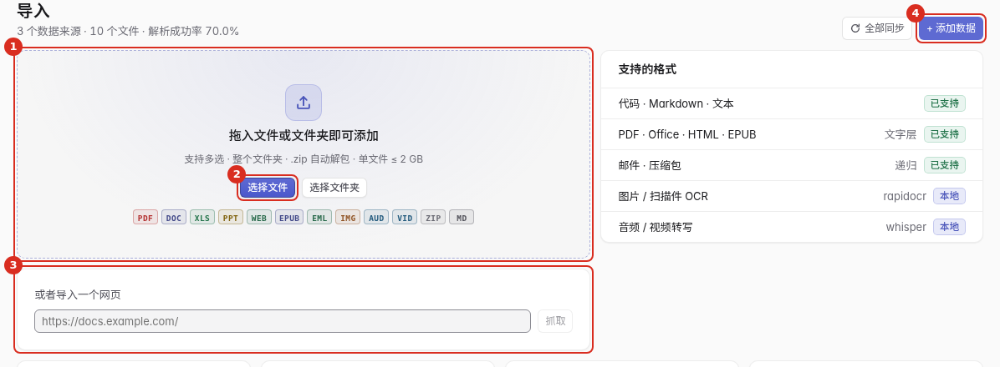

### 7.1 上传文件和文件夹 {#upload}

两种方式,效果一样:

**方式一:直接拖。** 把文件或整个文件夹拖进「导入」页的虚线框(电脑上)。**方式二:点按钮。** 点「选择文件」或「选择文件夹」(手机上点一下会弹出三选一:拍照、从相册选、选择文件)。

想先挑一挑、再统一设置集合和标签,用右上角的「+ 添加数据」:

1. 选来源类型「上传文件」。
2. 把文件拖进来,或点「选择文件」。选好的文件会列在下面,显示类型、大小和「待上传」,点右边的 × 可以移除。
3. 选「目标集合」,需要的话加几个「标签」。
4. 点「开始解析」。

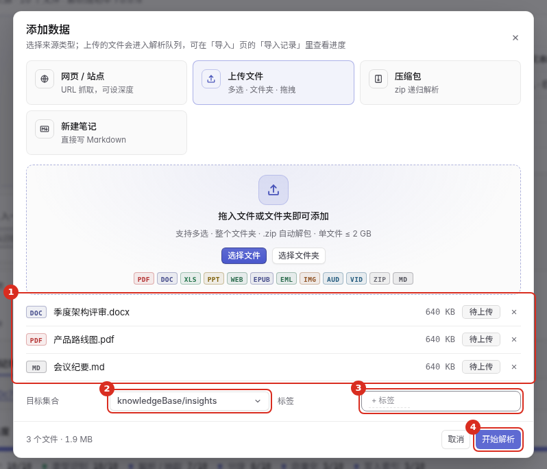

**大小限制。** 单个文件默认不超过 512 MB(拖入区会写出你当前的上限,管理员可以调整)。你的账号还有总存储配额,在「个人设置 → 我的用量」里看。

**支持的格式。** 代码、Markdown、文本;PDF、Office、HTML、EPUB(取文字层);邮件和压缩包(递归解析)。图片 / 扫描件(OCR)和音视频(转写)取决于管理员是否启用了对应组件,拖入区旁的「支持的格式」会标出「本地」或「未启用」。

**大文件放心传。** 文件会分片上传,每一片最多尝试 3 次;中途刷新页面,下次上传同一个文件会接着传,而不是从头开始。

### 7.2 压缩包 {#archive}

在「添加数据」里选「压缩包」,只接受 `.zip`。上传后自动解包并递归解析里面的每个文件;压缩包套压缩包的最大层数默认是 3 层,由管理员设置。

### 7.3 导入网页 {#web}

在「导入」页的「或者导入一个网页」输入框里粘贴网址(必须以 `http://` 或 `https://` 开头),点「抓取」。这会打开「添加数据」,让你确认几项再开始:

- **抓取深度**:1 / 2 / 3,数字越大抓得越深、花的时间也越长。只想要这一页就选 1。
- **域名白名单**:留空表示只允许抓你填的这个域名;要允许其它域名,用逗号分隔写在这里。
- **显示名**:留空时自动取。
- **目标集合**和**标签**。

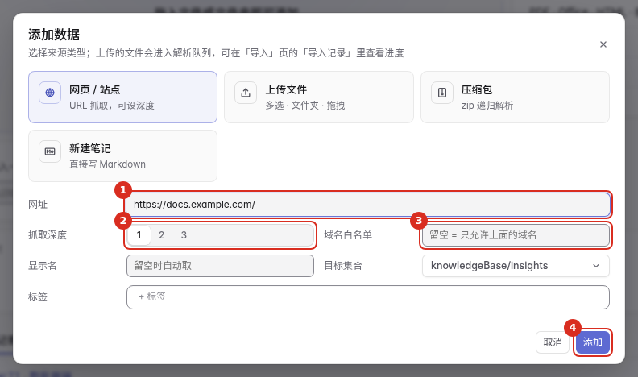

### 7.4 新建笔记 {#note}

在「知识库」页点「新建」,或在「添加数据」里选「新建笔记」。写标题、正文(Markdown),选一个种类,加标签,最后点右上角的「发布」。笔记里可以插入图片和附件,单个不超过 200 MB。

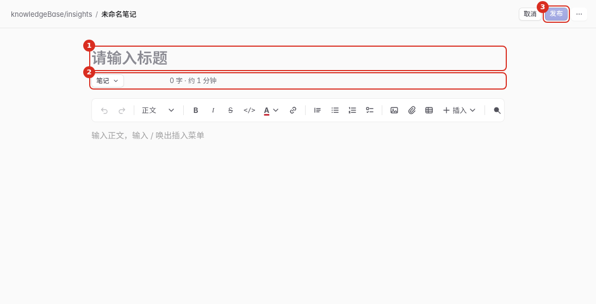

**写到一半不用手动保存。** 标题、正文、标签和种类会自动存在你这台设备的浏览器里,关页面、切到别的应用、断网、浏览器崩溃都不会丢。下次打开同一篇笔记会直接回到编辑状态,接着写;没发布的新笔记,在知识库列表顶上有一行「继续写『……』」,点一下就回来,右边的 × 是丢弃。顶上会写「已恢复……没写完的内容」,点「放弃这些修改」可以退回到上次保存的样子。

几点要知道:

- 草稿**只在这台设备的这个浏览器里**,换设备看不到;清除浏览器数据会一并清掉。点「保存」或「发布」之后草稿就清掉了。
- 如果你离开之后这篇笔记被别人改过,系统不会悄悄用旧草稿盖掉他们的修改,而是在顶上问你「恢复草稿」还是「丢弃」。
- **多人同时编辑**时,正文以大家共享的内容为准,实时同步,不靠本机草稿。只有你**断网期间写的、还没同步出去**的内容才会存成草稿;重新打开时它**不会自动写回**(以免盖掉别人的修改),而是让你选「复制出来」自己决定放哪里。
- 草稿保留 30 天。

### 7.4.1 引用文件、模板和另一篇笔记 {#note-links}

写笔记或改文档时,可以让一段文字指向知识库里的**文件**、**模板**或**另一篇笔记**。点编辑器工具栏的「插入」菜单,选「引用文件 / 模板」,再选集合、输入关键词,点结果就会把链接插到光标处。要一次引用多个文件时,先勾选结果左侧的方框,再点「插入选中」;也可以直接手写下面的语法。

| 要引用的目标 | 写法 | 例子 |
|---|---|---|
| 同一个集合里的文件 | 相对当前文件的路径 | `[利润表](利润表/利润表-最新.xlsx)` |
| 其它集合里的文件 | `kb://<集合>/<路径>` | `[模板](kb://_global/模板/周报模板.md)` |
| 一篇笔记 | `kb://note/<笔记 id>` | `[上次的结论](kb://note/01a19f63-f0ea-72fe-aa19-9998f6e2e5ad)` |
| 模板下载 | 在文件地址后加 `?download=1` | `[下载周报模板](kb://_global/模板/周报模板.docx?download=1)` |

- 路径里的中文、空格会被编辑器自动编码;手写时也可以直接写中文,打开时会自动解码。
- 相对路径以**当前文件所在目录**为基准;写笔记时以**集合根目录**为基准。不能用 `..` 跳出集合,也不能写 `D:\...` 这种原电脑路径。
- 只写文件名(例如 `[说明](README.md)`)表示同目录下的 `README.md`;不确定文件在哪时,先用「引用文件 / 模板」搜一下,别猜路径。
- `[[...]]` 双链也能识别,主要兼容 Obsidian 导入的内容;新写的内容建议用上面的 Markdown 链接,分享页和导出后都能点。
- 代码块和行内代码里的方括号**不算引用**,不会被体检,也不会出现在引用清单里。

编辑器不会自动改写你写的正文。引用指向的文件不在、没有权限或语法不对时,正文上方会出现一条**引用体检**提示,列出哪一行有问题;点「引用」还能看到这篇文档引用了谁、谁引用了它。

编辑时,「引用」面板里每个「未找到」的文件后面有两个按钮:

- **上传补上**:选一个本地文件,系统按这条引用解析出的目标路径上传,不用自己找目录;上传后体检会重新检查。
- **从库中选择**:搜索知识库里的文件,选中后把正文里这条旧地址替换成新地址;替换完仍要点「保存」。

删除或移动文件时,确认框会先告诉你「有 N 篇文档引用了它」。这只是提示,不会阻断操作,也不会替你改别人的正文;删完 / 移完需要自己回到那些文档里修引用。

「导入」页的**引用体检**也能一次检查刚导入的 Markdown:断链会按文件和行号列出来。点「选文件补传」可以一次选多个文件,系统按断链的目标路径放置;名字对不上路径的文件会跳过并说明,不会猜着上传。

**用 MCP 写笔记时**,Agent 不能上传文件,只能引用已经存在的路径:

1. 先调 `list_files` 找准确路径(返回 `collection`、`path`、`name`,模板会带 `template: true`);
2. 用相对路径或 `kb://` 拼进 `body`;
3. 调 `save_insight` 时用 `collection` 指定写进哪个集合,带 `strict_links: true` 让明显写坏的引用直接报错;
4. 看返回的 `links`,或对目标再调 `check_links`,确认 `ok` 再结束。

`doc_edit` 改已有文档时同样在返回里带 `links`;想查「谁引用了我」用 `doc_links`。

### 7.4.2 版本历史和对比 {#versions}

笔记和文件每保存一次就记一条版本,存在库里,不会被后来的覆盖。文档从上传进来的那一刻就有 v1,笔记从新建那一刻就有 v1(谁建的、原始内容都在),所以第一次改动之前的原文也找得回来;同名文件重新上传会接在新版本后面,不会拿旧正文冒充「当前」。打开条目后点工具栏的「属性」按钮,切到「历史版本」页签:

- 列表按时间从新到旧,每条写着版本号、是谁、什么时候、多大。
- 点「对比」把这一版和它的上一版逐行比出来:新增的行标绿(+),删掉的行标红(−,内容还在行里,颜色只是标记)。打开「只看改动」会把没动过的行折叠起来,长文档也能一眼看到改了哪几行。
- 点「恢复」把正文换回那一版。**恢复本身也会记成一个新版本**,所以恢复错了还能再恢复回来。笔记正在编辑时不给恢复,先保存或取消。
- 二进制文件(Word、Excel、PDF……)也记版本,能看到谁在什么时候传的、多大,但没法逐行对比,只能整份恢复。

命令行和 MCP 也能取:用 `file_versions` 列版本、`file_version` 取某一版的全文、`restore_file_version` 恢复。

### 7.5 遇到重复文件 {#duplicates}

上传前系统会按**文件内容的指纹**和集合里已有的文件比对,有重复时弹出「发现重复文件」:

- **完全相同**(指纹一致):一律跳过,不占上传流量(秒传)。这一项只展示,不能改。
- **同名但内容不同**:每个文件单独选「跳过」「覆盖」或「保留两者」。**默认是「保留两者」**,不会丢数据。
- 底部有「全部应用」可以一次设好;打开「记住本次选择」,以后同样的情况不再问。
- 点「继续上传 N 个」才真正开始,N 已经扣掉了会被跳过的文件。

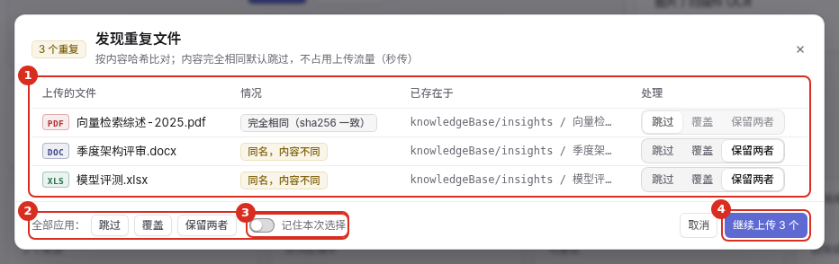

### 7.6 看上传进度 {#progress}

开始上传后,页面底部中间会出现一个小胶囊,写着当前的上传状态、「已完成 / 总数」和一条总进度条。**切换页面不会中断上传。**

点开胶囊是逐个文件的列表,顶上一行写着「已传 / 总量 · 速度 · 剩余时间」,每个文件有自己的进度条和状态(百分比、完成、跳过、失败、排队)。
还没开始传字节的阶段,状态会写清楚在做什么,进度条上是来回滑动的条纹,表示在忙、没有卡住:

- **校验文件**:先算文件的指纹(文件越大越久);
- **检查重复**:问服务器有没有同样的文件;
- **上传中**:显示百分比,传到一半也会动;
- **合并校验**:传完后服务器合并分片、核对指纹。**百分比到这一步通过后才是 100%**。

手机上胶囊里保留百分比,详细数字点开看。里面可以:

- 「暂停」:不再开始新的文件(正在传的文件会传完);再点「继续」。
- 「清空」:全部结束后清掉列表。
- 底部「在『导入记录』里查看进度」直达解析进度。

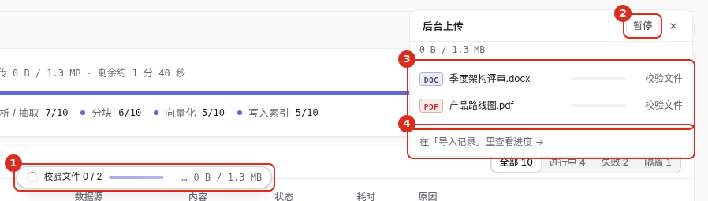

> **提示** 上传完成只代表文件到了服务器。要能被搜到,还要经过解析和建立索引,这一步的进度看下一节。

### 7.7 看解析进度、重试失败 {#records}

「导入」页的「导入记录」页签,按文件列出解析情况。每个文件依次经过「排队 → 解析中 → 分块 → 向量化」,最后是「成功」。其它状态:

- **失败**:这一行有「重试」按钮;顶部还有「重试失败 N」可以一次全部重试。
- **隔离**:超出限制或格式异常的文件。
- **跳过**:按策略没有导入的文件。

页面顶部有四个数字:文件总数、待解析、解析失败、已隔离,点一下就直接筛出对应的文件。下方可以按「全部 / 进行中 / 失败 / 已隔离」筛选。

默认显示最近一个批次(一次上传算一个批次),上方有「总体进度」条。批次进行中时还可以:

- **暂停 / 继续**:暂停后不再开始新的文件,点「继续」恢复。
- **整批撤销**:确认框会写明「在途文件会回滚,已完成的文件保留」,点「取消批次」才真正执行。

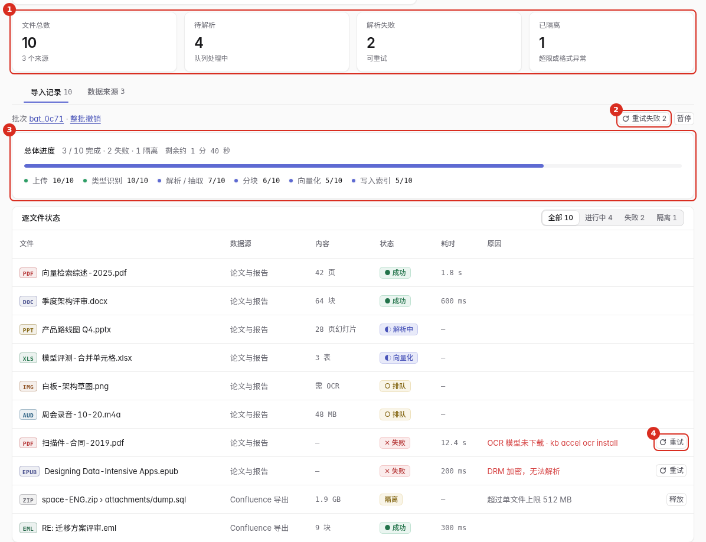

### 7.8 同步和移除数据来源 {#sources}

「导入」页的「数据来源」页签列出你的网页、上传、压缩包、笔记这些来源,可以按「全部 / 网页 / 上传 / 笔记」筛选。

- **同步**:重新读取这个来源。网页会重新抓取;行末有「同步」,右上角有「全部同步」。
- 点一行进入详情,能看到类型、位置、目标集合、标签、文件数、最近同步和最近一次错误,并可以「同步」或「移除」。
- **移除**要确认:它索引出来的块、向量与文件都会清掉,不能恢复。

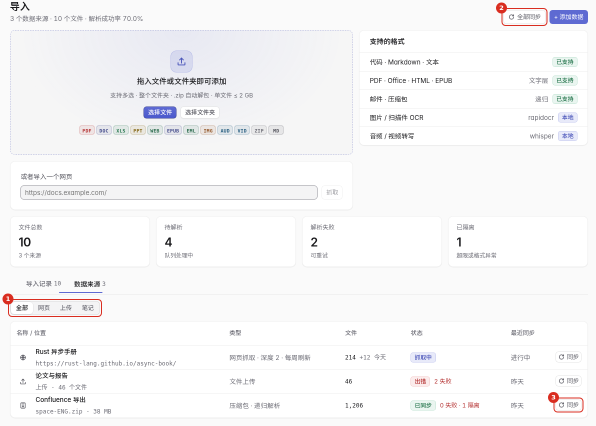

### 7.9 误删了怎么办 {#undo}

删除一篇笔记时,确认框会提示「可以在『审计 / 批次』里撤销」。那一页属于管理组,普通用户看不到。**误删请尽快联系管理员**,由他们按批次撤销。

### 7.10 服务器目录和 Git 仓库 {#server-sources}

读取服务器上某个路径、或克隆一个 Git 仓库的来源,只有管理员能添加,在「管理 → 项目与集合」里管理。普通用户的「导入」页不提供这两类。

### 7.11 让内容保持最新:不同类型的内容怎么接入 {#keep-fresh}

知识库里的内容不一定是代码,也不一定有 Git:可能是一批制度、规则、产品文档,也可能就是几条随手记下的经验。**怎么让它们随着源头自动更新,取决于内容放在哪、是什么类型。** 先对照下表选做法,再看下面的说明。

| 你的内容 | 怎么接入 | 怎么保持最新 | 更新有多快 |
|---|---|---|---|
| **服务器上的目录,是 Git 仓库**(代码、带版本的文档) | 登记为「项目」 | **实时监听**(默认开) + **提交后自动索引**(推荐开) | 几秒;切分支、拉代码这类一次改很多文件的操作,由提交后自动索引按差异一次补齐 |
| **服务器上的目录,不是 Git**(规则、制度、资料文件夹) | 同样登记为「项目」,**不需要 Git** | **实时监听**(默认开)。没有「提交后自动索引」,也不需要 | 几秒 |
| 服务器上的目录,只想当资料看,不想按项目管理 | 添加「数据来源」→ 本地目录 | 设「定时刷新」间隔(见下面的说明),或手动点「同步」 | 不是实时,按间隔(例如每 10 分钟) |
| **文件在你自己的电脑上** | 在「导入」页上传文件或文件夹 | 不会自动感知变化:改了的文件**重新上传**即可,没变的会秒传跳过(见 7.5) | 取决于你什么时候上传 |
| 托管在别处的 Git 仓库(GitHub 等) | 添加「数据来源」→ Git | 设「定时刷新」间隔,或手动「同步」;只有变化的文件会重新处理 | 不是实时,按间隔 |
| 网页 | 添加「数据来源」→ 网页(限定域名、抓取深度) | 设「定时刷新」间隔,只有内容变了的页面才会重新处理 | 不是实时,按间隔 |
| 在页面里**直接写**的笔记、通过 MCP 存下的经验 | 不需要接入 | 保存就进索引,不用做任何设置 | 几秒 |
| 在知识库里**在线编辑**的文本 / Markdown / 表格文件 | 不需要接入 | 保存后自动更新索引 | 几秒 |

**关于「定时刷新」。** 数据来源(本地目录、Git、网页)可以设一个刷新间隔(分钟数,例如 60 = 每小时),到点自动重新同步一次,没变的内容直接跳过。这个间隔由管理员或接口调用方设置(`add_source` / `update_source` 的 `refresh_minutes`);来源列表里会显示「每小时同步」「每小时拉取」「每天刷新」这样的状态;不设间隔的来源只在你点「同步」时更新。**数据来源不做实时监听**,要实时更新请按下面第 1 条登记为项目。

**推荐做法**

1. **只要目录在服务器上,不管是不是 Git,都登记为「项目」**(命令行 `kb project add <目录>`,或管理员在「管理 → 项目与集合」里添加)。登记后会自动建好集合并开始第一次索引,**同时自动获得实时监听**,约半分钟内开始监听,不用重启服务。
2. **Git 仓库再打开「提交后自动索引」**(新登记的 Git 项目已经默认打开;已有的项目在项目页点这个开关,或运行 `kb hooks install <项目>`)。它给仓库装 4 个钩子(提交、合并、切分支、改写历史),不会覆盖你已有的钩子:原来的钩子会改名保留并照常先执行,服务没开时也不影响 git 操作。非 Git 目录没有钩子,只靠文件监听。
3. **不要关掉实时监听**(设置里 `[index] watch`,默认就是开)。每晚凌晨 3 点(站点时区)还有一次自检,会核对文件和索引是否一致,发现漂移自动补上,当作兜底,不能代替监听。
4. **文件在别的机器上、又希望准实时**:把目录放到服务器上(同步、挂载、`rsync` 都行)再按第 1 条登记;或者写个脚本,定时把变化的文件上传(先做「去重预检」,只传有变化的)。
5. **「自动提炼」和「允许云端大模型」默认是关的,需要时再开。** 开了以后,项目里的会话和提交内容会发给外部的大模型接口去整理成经验条目,请先确认内容允许外发。它们和「内容保持最新」没有关系,不开也完全不影响索引和搜索。

**创建索引是怎么回事**

- **登记项目**后会自动排一个首次全量索引,不用手动触发。**添加数据来源只完成登记,不会自己开始**:要在来源列表点一次「同步」,或者等「定时刷新」到点,才会抓取 / 解析第一批内容。进度在「任务」页看(命令行 `kb jobs`)。大致每秒处理几个块,一万块左右需要一个小时上下;别的任务多的时候首次索引要先排队,晚一点开始是正常的。
- 之后的变化(监听、钩子、定时刷新、夜间自检触发的)都是**增量**:内容没变的文件直接跳过,不会重新处理。
- 表里的行数够多(默认一万行以上)时会自动建向量索引,全文索引自动维护,都不用手动建。
- 不是什么都会被索引:单个文件默认超过 200 KB 会跳过(Markdown 放宽到 2 MB),`node_modules`、`dist`、`target`、锁文件等默认排除,项目里的 `.gitignore` 也生效;可执行文件这类二进制不索引(PDF、Word、Excel、PowerPoint 等文档会解析出文字再索引)。想改排除规则,管理员在项目设置里改,改完可以立即重新索引。

**规则、制度这类文字内容怎么写更容易被搜到**

- 用 Markdown(`.md`)或纯文本,**按标题分节,一条规则一个小节**。知识库按一、二、三级标题切块,一个小节命中一次搜索,搜索结果能直接定位到那一条。
- 标题写成能单独看懂的话(「退款超过 7 天要主管审批」比「第 3 条」好找),正文里别只写「同上」「见上文」。
- 一个文件别写成几万字的长文;按主题拆成几个文件,更新时只会重新处理改动的那个。

**怎么确认实时更新生效了**

改动目录里的一个文件(比如在某个文件里加一句话),过几秒到「搜索」里搜这句话。搜得到就说明监听正常;搜不到,先到「任务」页看有没有排队中的任务(忙的时候会晚几十秒),还不行再联系管理员。**网络盘(NFS / SMB)或某些挂载进来的目录通常收不到系统的文件变化通知**,这类目录靠夜间自检补上,或者改用上表里的「定时刷新」。

## 8. 常见问题与排查 {#faq}

### 令牌和连接 {#faq-token}

**「个人设置」里没有「访问令牌」卡片。** 账号没有开通「API 令牌与 MCP」功能。联系管理员。

**创建时提示「已经有一个叫……的令牌了」。** 同一个账号下令牌名不能重复。换个名字,或者先撤销旧的那个。

**令牌复制漏了/丢了。** 找不回来。撤销旧令牌,再新建一个。

**客户端连接返回 404。** 服务没有开启 `/mcp`(默认关闭)。请管理员在 `config.toml` 的 `[mcp]` 里把 `transports` 设成 `["stdio", "http"]` 并重启服务。

**客户端连接返回 401。** 按顺序检查:`Authorization` 头是不是 `Bearer <令牌>`(中间有一个空格,没有多余的引号);令牌是不是完整复制的,是否以 `kb_` 开头;令牌是不是已经被撤销(看「访问令牌」卡片的状态);类型是不是 MCP(API 令牌连不了 `/mcp`)。

**客户端连接返回 403。** 请求带了不被允许的 `Origin`(常见于浏览器里的网页客户端)。非浏览器客户端不带 `Origin`,不受影响。

**连不上,或者提示主机不被允许。** 如果知识库经过反向代理暴露在域名上,管理员要把域名加进 `mcp.allowed_hosts`。

**返回 503「远程 MCP 暂时不可用」。** 服务端暂时无法为令牌用户提供 MCP。稍后重试,持续出现请联系管理员。

**能连上,但搜不到别人分享给我的内容。** 令牌创建时没有打开「包含共享给我的内容」。这个开关创建后不能改,撤销后重建一个并打开即可。

**工具列表里没有某个工具。** 工具是否可用取决于账号的功能和令牌类型。用 `GET /api/v1/capabilities?surface=mcp`(带令牌)可以看到你的令牌实际能用的清单。

### 导入和数据 {#faq-data}

**拖进去的文件被拒绝了。** 先看有没有超过单文件上限(拖入区会写出上限),再看「我的用量」里存储是否已经超额。超额后不能再上传,删掉不用的文件就会自动恢复。

**文件上传完了,但搜不到。** 上传完成只代表文件到了服务器,还要经过解析和建立索引。到「导入记录」看这个文件的状态:排队或解析中就是还没轮到,失败可以点「重试」。

**文件显示「失败」。** 点那一行的「重试」,或者顶部的「重试失败 N」。反复失败时,看这一行的「原因」列,再决定是换一个文件还是联系管理员。

**文件显示「隔离」。** 文件超出限制或格式异常,没有被处理。换一个更小或正常的版本重新上传。

**大文件看起来卡在 0%。** 上传前要先计算文件指纹,文件很大时需要等一会儿。这时上传面板里的状态是「校验文件」,进度条是来回滑动的条纹,不是卡住了;开始传字节后才会出现百分比。浏览器内存不够时可能失败,可以把文件拆开再传。

**图片和音视频没有被识别出文字。** OCR 和转写需要管理员启用对应组件。「支持的格式」里会标出「本地」或「未启用」。

**手机上没有「选择文件夹」。** 手机浏览器不支持选文件夹。可以先打成 `.zip` 再上传。

**微信或 QQ 里点下载没反应。** 这些内置浏览器会拦截下载。页面上有提示和「复制链接」,复制后用手机自带的浏览器打开再下载。

**引用显示「未找到」。** 先看提示里的路径:同集合文件是相对当前文件目录的,笔记是相对集合根的。文件确实没上传时,点「引用」面板里的「上传补上」,或按路径把文件补传到同一目录;目标其实在库里、只是路径写错了,用「从库中选择」替换。系统只提示,不会自动改你写的字。

**误删了笔记。** 见 7.9,联系管理员按批次撤销。

## 9. 名词对照 {#glossary}

| 名词 | 意思 |
|---|---|
| 访问令牌 | 给其它程序(如 MCP 客户端、脚本)用的密钥,以 `kb_` 开头,只在创建时显示一次 |
| MCP | 让客户端把知识库当工具调用的协议;本文的客户端指 Kiro、Claude Code、Codex 这类 |
| 知识库 | 你的全部内容,也是侧栏里的「知识库」页 |
| 集合 | 知识库里的一组内容 |
| 笔记 | 你自己写的一篇 Markdown 内容 |
| 导入 | 把文件、文件夹、网页放进知识库的动作和页面 |
| 导入记录 | 「导入」页的页签,每个文件的解析进度,失败可重试 |
| 数据来源 | 「导入」页的页签,网页、上传、压缩包、手写笔记这些来源,可同步和移除 |
| 索引 | 让内容能被搜到的处理过程 |
| 秒传 | 内容与已有文件完全一致时,不重复传输 |
| 引用 | 正文里指向文件、模板或另一篇笔记的链接 |
| 出链 / 入链 | 这篇文档引用了谁 / 谁引用了这篇文档 |
| 引用体检 | 检查引用目标在不在、有没有权限,只提示,不自动改正文 |
| `kb://` | 跨集合引用文件、引用笔记时用的内部地址 |
